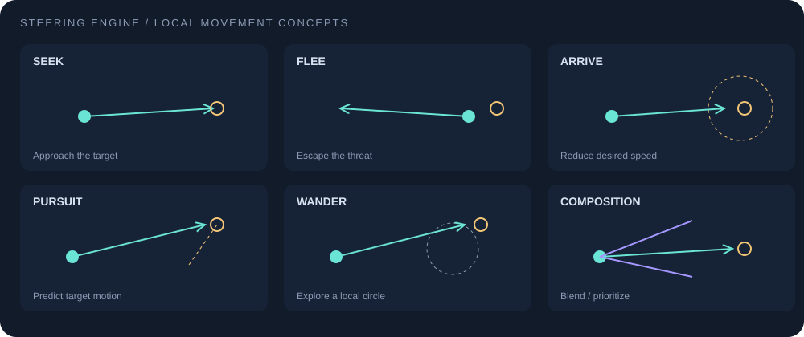

# steering_engine

[](https://github.com/kleberandrade/steering-engine/actions/workflows/ci.yml)
[](LICENSE)

**Composable 2D steering behaviors in pure Dart**, for Flutter games, autonomous
characters and simulations. No runtime dependencies, Flutter imports, IO or network
access in the core.

[Português](README.pt-BR.md) · [Getting started](doc/getting_started.md) ·
[Equations](doc/behaviors.md) · [Architecture](doc/architecture.md) ·
[Flutter lab](example/flutter_lab/README.md) · [Roadmap](doc/roadmap.md) ·
[Obstacle avoidance](doc/obstacle_avoidance.md) · [Path following](doc/path_following.md) · [Contributing](CONTRIBUTING.md)



## Status and installation

Initial development version: **0.1.0-dev.1**. This repository does not imply a
pub.dev publication. Use a local dependency while developing:

```yaml
dependencies:
  steering_engine:
    path: ../steering-engine
```

Requires Dart **>=3.3.0 <4.0.0**. The optional Flutter lab has its own SDK constraint
and does not add Flutter to your core application dependencies.

## Make a character arrive

```dart
import 'package:steering_engine/steering_engine.dart';

void main() {
  const engine = SteeringEngine();
  var agent = SteeringAgent(
    position: Vec2.zero,
    maxSpeed: 80,
    maxAcceleration: 160,
  );
  final behavior = Arrive(Vec2(200, 100), slowingRadius: 80);

  for (var frame = 0; frame < 600; frame++) {
    agent = engine.step(agent, behavior, 1 / 60);
  }
  print(agent.position); // Near (200, 100), with bounded deceleration.
}
```

Position uses your distance units; velocity is units/second, acceleration is
units/second², and `dt` is seconds. Render `agent.position` with Flutter
`CustomPainter`, or copy it into a Flame component in your game loop.

## Choose a behavior

| Behavior | Goal | Important detail |
| --- | --- | --- |
| `Seek` | Approach a position | Can overshoot; does not plan a stop |
| `Flee` | Move away from a position | Exact overlap has no escape direction |
| `Arrive` | Approach and slow down | Brakes inside the stop radius; no teleportation |
| `Pursuit` | Intercept a moving target | Linear prediction, bounded by `maxPrediction` |
| `Evade` | Escape a moving threat | Flees the predicted position |
| `Wander` | Explore without a fixed destination | Own one seeded, stateful instance per agent |
| `Brake` | Reduce velocity toward zero | Obeys the acceleration limit |

`Pursuit` and `Evade` capture immutable target snapshots: rebuild them when the
target updates. All built-in behaviors return bounded **acceleration**, not force.

## Follow a route

```dart
final route = SteeringPath([
  Vec2(80, 0), Vec2(80, 80), Vec2(160, 80),
]);
final follower = FollowPath(route, waypointRadius: 5, slowingRadius: 35);
// Keep the follower instance across frames: it owns the current waypoint.
agent = engine.step(agent, follower, 1 / 60);
```

Use `loop: true` on SteeringPath for a repeating route. Inspect
`follower.waypointIndex` and `currentTarget`, or call `reset()` to rewind.
Run `dart run example/path_following.dart`. See the [route guide](doc/path_following.md).

## Steer around static obstacles

```dart
final avoidance = ObstacleAvoidance([
  CircleObstacle(Vec2(80, 0), radius: 15),
], agentRadius: 5, safetyMargin: 4, lookAheadTime: 1.5);
final steering = PrioritySteering([
  avoidance,
  Arrive(Vec2(180, 0), slowingRadius: 40),
]);
```

The scan accounts for agent size and selects the first predicted circle surface.
It requests lateral acceleration and braking, or zero when the local path is clear.
Compose it before a destination or route follower. `findThreat` exposes read-only
debug geometry. This reactive method does not resolve or guarantee prevention of
collisions. See the [visual guide and limits](doc/obstacle_avoidance.md).
Run `dart run example/obstacle_avoidance.dart` for a complete checked simulation.

## Combine behaviors

```dart
final steering = WeightedBlend([
  WeightedBehavior(Arrive(Vec2(300, 100)), weight: 0.8),
  WeightedBehavior(Wander(seed: 42), weight: 0.2),
]);
```

Weights multiply accelerations without automatic normalization. The sum is capped
to the agent's acceleration limit. Zero weight skips evaluation entirely.
For ordered alternatives, `PrioritySteering([primary, fallback], epsilon: 0.001)`
chooses the first output whose magnitude exceeds the threshold. Later behaviors
are not evaluated. It is selection, not an accumulated force budget.

Implement `SteeringBehavior.calculate(agent, dt)` to add a custom algorithm.
The engine caps custom outputs before integrating motion.

## Explore visually

```sh
cd example/flutter_lab
flutter pub get
flutter run -d chrome
```

The lab offers all seven local behaviors, path following, obstacle avoidance, weighted and priority compositions,
click/drag targets, a moving target, a seeded wander stream, velocity and
acceleration arrows, trails, adjustable limits, pause, reset and fixed-step
advancement. World edges wrap in the demo; the core leaves boundaries to callers.

## Numerical model and limits

- Immutable vectors and agent snapshots; copied, unmodifiable composition lists.
- Validated finite parameters, nonnegative limits and `dt`; positive response time.
- Semi-implicit Euler: update velocity, cap speed, then update position.
- `dt == 0` is an engine no-op and does not evaluate stateful behaviors.
- Small fixed steps are recommended. Large steps can overshoot, and blending
  conflicting goals may cancel motion or prevent arrival.
- Wander seeds reproduce matching call sequences on the same runtime; trajectories
  are not promised identical across different time steps or runtimes.
- Flocking, collision resolution and vehicle dynamics are future work.
  Avoidance currently supports static circles; walls and moving obstacles are not modeled.
  Steering can consume a planned route; it does not replace pathfinding.

See [equations and conventions](doc/behaviors.md) for exact formulas.

## Development

```sh
dart pub get
dart analyze --fatal-infos
dart test
dart run example/steering_engine_example.dart
dart run example/composition.dart
```

CI also checks JavaScript compilation, the Flutter lab and a publication dry run.
See [CONTRIBUTING.md](CONTRIBUTING.md) for the complete checks.

## Scientific references

1. Reynolds, C. W. (1999). [Steering Behaviors for Autonomous Characters](https://www.red3d.com/cwr/steer/gdc99/). Game Developers Conference. Conceptual basis for local movement and behavior composition.
2. Reynolds, C. W. (1987). [Flocks, Herds, and Schools: A Distributed Behavioral Model](https://www.red3d.com/cwr/boids/). SIGGRAPH. Foundation for the planned collective behaviors.

This implementation uses an explicit acceleration/response-time convention and
bounded prediction, documented above; it is not a verbatim port of Reynolds's demos.
