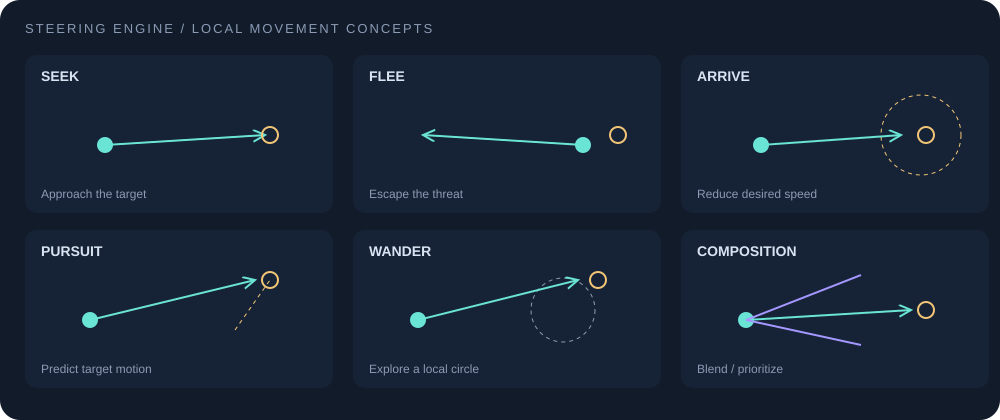

# steering_engine

**Steering behaviours 2D combináveis em Dart puro**, para jogos Flutter,
personagens autônomos e simulações. O núcleo não possui dependências em runtime,
imports de Flutter, IO ou acesso à rede.

[English](README.md) · [Primeiros passos](doc/getting_started.pt-BR.md) ·
[Equações](doc/behaviors.pt-BR.md) · [Arquitetura](doc/architecture.md) ·
[Laboratório Flutter](example/flutter_lab/README.md) · [Roadmap](doc/roadmap.md)



## Estado e instalação

Versão inicial em desenvolvimento: **0.1.0-dev.1**. A presença do código no
GitHub não significa publicação no pub.dev. Para desenvolvimento local:

```yaml
dependencies:
  steering_engine:
    path: ../steering-engine
```

O núcleo exige Dart **>=3.3.0 <4.0.0**. O laboratório possui uma restrição própria
de Flutter e não adiciona essa dependência ao núcleo.

## Faça um personagem chegar ao destino

```dart
import 'package:steering_engine/steering_engine.dart';

void main() {
  const engine = SteeringEngine();
  var agent = SteeringAgent(
    position: Vec2.zero,
    maxSpeed: 80,
    maxAcceleration: 160,
  );
  final behavior = Arrive(Vec2(200, 100), slowingRadius: 80);
  for (var frame = 0; frame < 600; frame++) {
    agent = engine.step(agent, behavior, 1 / 60);
  }
  print(agent.position); // Próximo de (200, 100), desacelerando até parar.
}
```

Escolha suas unidades de distância. A velocidade será unidades/segundo, a
aceleração unidades/segundo² e `dt` será em segundos. Desenhe a posição com
`CustomPainter` ou copie-a para um componente Flame no loop do jogo.

## Comportamentos disponíveis

| Comportamento | Objetivo | Particularidade |
| --- | --- | --- |
| `Seek` | Buscar uma posição | Pode ultrapassar o destino |
| `Flee` | Fugir de uma posição | Na sobreposição exata não existe direção de fuga |
| `Arrive` | Chegar desacelerando | Freia dentro do raio de parada, sem teletransportar |
| `Pursuit` | Perseguir um alvo móvel | Previsão linear com horizonte limitado |
| `Evade` | Escapar de uma ameaça móvel | Foge da posição prevista |
| `Wander` | Explorar sem destino fixo | Uma instância com estado por agente; seed opcional |
| `Brake` | Reduzir a velocidade até zero | Respeita o limite de aceleração |

`Pursuit` e `Evade` recebem snapshots imutáveis: recrie o comportamento quando o
alvo se mover. As saídas representam **aceleração**, não força física.

## Composição

```dart
final steering = WeightedBlend([
  WeightedBehavior(Arrive(Vec2(300, 100)), weight: 0.8),
  WeightedBehavior(Wander(seed: 42), weight: 0.2),
]);
```

Os pesos multiplicam as acelerações sem normalização automática; a soma é limitada
à aceleração máxima do agente. Peso zero desativa a avaliação do comportamento.
`PrioritySteering([principal, alternativa], epsilon: 0.001)` escolhe a primeira
saída acima do limiar e não avalia as demais. É seleção por prioridade.
Implemente `SteeringBehavior.calculate(agent, dt)` para criar seus algoritmos.

## Siga uma trajetória

```dart
final rota = SteeringPath([
  Vec2(80, 0), Vec2(80, 80), Vec2(160, 80),
]);
final seguidor = FollowPath(rota, waypointRadius: 5, slowingRadius: 35);
// Preserve o seguidor entre os frames: ele mantém o waypoint atual.
agente = engine.step(agente, seguidor, 1 / 60);
```

Use `loop: true` na rota para repetir o percurso. Consulte `waypointIndex` e
`currentTarget` ou chame `reset()` para recomeçar. O último waypoint de uma rota
aberta usa aproximação com frenagem. Execute `dart run example/path_following.dart`.
Veja o [guia de trajetórias](doc/path_following.md), também em português.

## Desvie de obstáculos estáticos

```dart
final avoidance = ObstacleAvoidance([
  CircleObstacle(Vec2(80, 0), radius: 15),
], agentRadius: 5, safetyMargin: 4, lookAheadTime: 1.5);
final steering = PrioritySteering([
  avoidance,
  Arrive(Vec2(180, 0), slowingRadius: 40),
]);
```

A detecção considera o tamanho do agente e escolhe a primeira superfície circular
prevista à frente. O comportamento combina aceleração lateral e frenagem e libera
a próxima prioridade quando não detecta ameaça. `findThreat` permite desenhar a
geometria sem alterar estado. É uma heurística local, sem garantia de impedir
colisões. Veja o [guia visual](doc/obstacle_avoidance.md) e execute
`dart run example/obstacle_avoidance.dart` para testar a cena completa.

## Simule um grupo com flocking

Crie um `AgentNeighborhood(agents)` por quadro e calcule todos os agentes com
essa mesma observação. Separation, Alignment e Cohesion podem ser usados
isoladamente; Flocking os combina por WeightedBlend.

```dart
final observed = AgentNeighborhood(agents);
final flocking = Flocking(observed,
  separationRadius: 25, neighborRadius: 80,
  separationWeight: 1.5, alignmentWeight: 1, cohesionWeight: 0.7,
);
agents = [
  for (final agent in agents)
    const SteeringEngine().step(agent, flocking, 1 / 60),
];
```

Substitua o quadro completo depois de calcular o próximo estado. A consulta
exclui o observador por identidade: use o snapshot original, sem copiá-lo.
O custo do grupo é O(n²) nesta versão. Veja o [guia visual e as equações](doc/flocking.md)
e execute `dart run example/flocking.dart`. O laboratório permite comparar as
regras e ajustar pesos para 24 agentes; flocking não resolve colisões.

## Laboratório visual

```sh
cd example/flutter_lab
flutter pub get
flutter run -d chrome
```

Compare os comportamentos individuais e coletivos, o seguidor de trajetória, o desvio de obstáculos e as duas composições, mova o alvo com o mouse,
observe os vetores de velocidade e aceleração, ajuste os limites e avance quadro
a quadro. Pursuit e Evade usam um alvo em órbita. As bordas do laboratório
reposicionam o agente no lado oposto; esse recurso pertence apenas ao exemplo.

## Convenções e limites

O integrador usa Euler semi-implícito com limites de aceleração e velocidade.
Use passos pequenos e fixos: passos grandes podem ultrapassar o alvo. `dt == 0`
não avalia os comportamentos no engine. Vetores, snapshots e listas de composição
são imutáveis. Parâmetros inválidos geram `ArgumentError` em runtime.

Wander repete sequências de chamadas com a mesma seed no mesmo runtime; passos de
tempo diferentes podem gerar trajetórias diferentes. A combinação de objetivos
opostos pode cancelar o movimento. Índices espaciais, resolução de colisões e dinâmica de
veículos estão no roadmap. Planejamento global de rotas continua separado.

Consulte [equações](doc/behaviors.pt-BR.md) e [contribuição](CONTRIBUTING.md).

## Referências científicas

1. Reynolds, C. W. (1999). [Steering Behaviors for Autonomous Characters](https://www.red3d.com/cwr/steer/gdc99/). GDC. Base conceitual dos comportamentos e da composição.
2. Reynolds, C. W. (1987). [Flocks, Herds, and Schools: A Distributed Behavioral Model](https://www.red3d.com/cwr/boids/). SIGGRAPH. Base dos comportamentos coletivos planejados.

Esta implementação explicita aceleração, tempo de resposta e previsão limitada;
não é uma transcrição dos exemplos originais de Reynolds.
