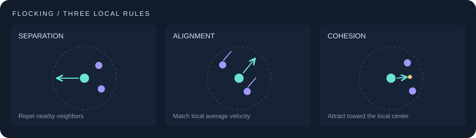

# Flocking / Movimento coletivo



## One observation per frame

Build an `AgentNeighborhood` from the **old** immutable agent snapshots, evaluate
all agents against it, and only then replace the frame:

```dart
final snapshot = AgentNeighborhood(agents);
final flocking = Flocking(snapshot,
  separationRadius: 25,
  neighborRadius: 80,
  separationWeight: 1.5,
  alignmentWeight: 1,
  cohesionWeight: 0.7,
);
final next = [
  for (final agent in agents)
    const SteeringEngine().step(agent, flocking, 1 / 60),
];
agents = next;
```

Do not replace elements of `agents` while later agents still read that array.
One shared observation prevents update-order bias. Rebuild the neighborhood and
behavior next frame; they intentionally retain the observation they received.
They have no hidden world clock or global registry.

## Neighborhood ownership and distance

The neighborhood copies its input, removes repeated **references** in insertion
order and exposes an unmodifiable list. Its `neighborsFor(observer, radius: ...)`
query excludes the observer by object identity and includes distances <= radius.
Pass the actual snapshot being updated, not a copy representing the same agent.
A distinct coincident snapshot remains a neighbor. Radius zero is a valid query;
the three steering rules require positive radii.

Queries scan the observation linearly. Whole-flock evaluation with these rules
is O(n²). There is no spatial index, field-of-view filter, collision solver or
wrapped distance calculation. The lab wraps positions visually; agents across
opposite edges do not count as nearby until their Euclidean distance qualifies.

## Exact acceleration conventions

Let A be the observer's maximum acceleration; R the rule radius; N its selected
neighbor set; q the vector from the observer to one neighbor; d = |q|. All rules
return zero when N is empty and validate nonnegative finite dt. Zero dt is pure;
the engine skips evaluation altogether for a zero-length step.

| Rule | Acceleration before final limiting |
| --- | --- |
| Separation | A × mean(-normalize(q) × (1 − d/R)) |
| Alignment | (limit(mean(neighbor.velocity), maxSpeed) − velocity) / responseTime |
| Cohesion | A × mean(q/R) |

Each result is limited to A. Means include every selected neighbor. A boundary
neighbor contributes zero repulsion. A coincident neighbor contributes zero
separation direction, with no invented asymmetric nudge. Handle exact overlaps
through spawn constraints or a separate contact model if needed.

Separation uses bounded **linear distance falloff**, not an inverse-square force.
Cohesion is linear positional attraction and does not subtract velocity; this
avoids explicit damping of shared translation.
Alignment matches velocity and therefore brakes toward stationary neighbors.
These are documented variants of Reynolds's local rules, not an exact port of
the 1987 implementation. They do not ensure a fixed group spacing or collision
avoidance. Tune distance, acceleration, step size and weights for your scene.

## Composition

Flocking owns one Separation, Alignment and Cohesion component and delegates the
weighted sum to the same `WeightedBlend` used elsewhere. Weights are finite,
nonnegative and not normalized; zero disables a component. Components remain
available as `flocking.separation`, `.alignment` and `.cohesion` for inspection
or independent use. Arbitrarily large weighted arithmetic may overflow and is
rejected rather than creating nonfinite agent state.

Flocking alone does not seek a destination. Add a separate Seek, Arrive or Wander
using a blend when the scene needs it, or put obstacle avoidance before flocking
in a priority selector. A destination contribution can conflict with local rules.
The lab labels its optional target attraction separately and lets you set it to
zero. Its 24-agent frame uses a seeded initial layout and velocities.

## Flutter import names

Flutter also defines an Alignment layout type. When both libraries are needed,
use `import 'package:steering_engine/steering_engine.dart' as steering;` and call
`steering.Alignment(...)`. The lab page instead hides Flutter's unused Alignment
from its Material import. / No Flutter, use um prefixo para distinguir a regra de
alinhamento da classe de posicionamento da interface.

## Examples and verification

Run `dart run example/flocking.dart`. It advances 24 agents against shared
snapshots for 20 simulated seconds. The Flutter lab offers Separation, Alignment,
Cohesion and Flocking modes, three weights, target-attraction control, a selected
agent's neighborhood, pause/step/reset and the existing motion limits.

Public-entry-point tests cover independent rule calculations, ownership,
identity, duplicate references, inclusive distance boundaries, symmetry,
translation, zero acceleration, weights, validation and frame-order independence.
A two-agent test compares integrated motion to an independent analytic solution
of the damped relative-motion equation before separation activates.

## Português

Crie um AgentNeighborhood com os snapshots antigos, calcule todos os agentes e
só depois substitua o quadro completo. Recrie a observação no próximo passo.
Isso evita que a ordem de atualização favoreça um agente. A lista é copiada,
imutável e sem referências duplicadas; o próprio agente é excluído por identidade.
Passe o snapshot original do observador, e não uma cópia dele.

Separation produz repulsão com intensidade linearmente menor conforme a distância
cresce. Alignment aproxima a velocidade da média dos vizinhos. Cohesion atrai
para a posição média, sem frear a translação compartilhada. As equações exatas
estão na tabela acima: são variantes explícitas das regras locais de Reynolds.

Flocking combina as três usando WeightedBlend; os pesos não são normalizados e
zero desativa a regra. Vizinhos na borda contam na média. Na sobreposição exata,
Separation não inventa uma direção. Nenhuma dessas regras resolve colisões ou
promete distância fixa entre os agentes.

A consulta de vizinhos é linear e a simulação completa é O(n²), sem índice
espacial. O laboratório reposiciona agentes ao cruzar as bordas, mas a distância
entre vizinhos continua euclidiana. Alvos e obstáculos são comportamentos
separados e podem ser combinados conforme a aplicação.

No laboratório, compare cada regra isolada e depois ajuste os pesos de Flocking.
A atração pelo alvo é independente e pode ser zerada. Pause permite avançar todos
os 24 agentes em um único passo; Reset repete a configuração inicial com seed 42.
