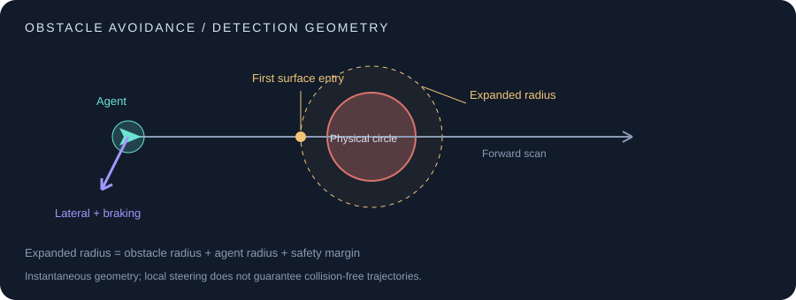

# Obstacle avoidance / Desvio de obstáculos



## Model

`CircleObstacle(center, radius: ...)` represents a static physical circle.
`ObstacleAvoidance` copies the obstacle list and has no mutable traversal state.
Use the same distance units as the agent; time is in seconds. It emits acceleration.

```dart
final avoidance = ObstacleAvoidance([
  CircleObstacle(Vec2(80, 0), radius: 15),
], agentRadius: 5, safetyMargin: 4, minLookAhead: 45, lookAheadTime: 1.5);

final steering = PrioritySteering([
  avoidance,
  Arrive(Vec2(180, 0), slowingRadius: 40),
]);
```

Keep avoidance before goal following so it can temporarily take control. With
no detected threat it returns zero, allowing the next behavior to run. A weighted
blend is also possible, but an opposing goal can cancel the avoidance response.
Use `FollowPath` as a fallback for routes; points inside circles may be unreachable.

## Geometry and response

For physical obstacle radius r, agent radius a and margin m, scan against a circle
of radius **R = r + a + m**. The extra margin expands detection; it is not a hard
minimum distance guaranteed by the integrator.

Heading h is normalized velocity; the left perpendicular is s = (-h.y, h.x).
The ray length is **L = max(minLookAhead, speed × lookAheadTime)**. For offset
q = obstacle.center − agent.position, along = dot(q,h) and lateral = dot(q,s).

Outside overlap, ignore circles with |lateral| > R. Otherwise:

```text
halfChord = R × sqrt(max(0, 1 − (lateral/R)²))
entry = along − halfChord
```

An entry inside [0,L] is a threat, including tangency and contact exactly at L.
Select the lowest entry distance, preserving input order on exact ties. This
selects the earliest **surface**, which may belong to a farther, larger circle.

Steer laterally away from the selected center and add a backward component with
relative `brakingWeight` (default 0.5); normalize and scale to maxAcceleration.
A centerline tie uses local +Y deterministically. For a circle whose expanded
region already contains the agent, request radial escape; coincident centers
use the same lateral fallback. An overlap is reported with entry zero. A stopped
agent scans only for overlap because it has no velocity heading.

`findThreat(agent)` exposes obstacle, entry distance, expanded radius and overlap.
`scanDistance(agent)` exposes L. Both are read-only queries suitable for debug
rendering. `calculate(agent, dt)` validates dt, and zero dt changes no state.
The engine still skips behavior evaluation entirely when its dt is zero.

## Limits and tuning

This is local reactive steering, not global path planning, a collision solver,
a braking-distance controller or a guarantee of collision-free motion. The core
does not push agents out of obstacles or clamp their positions. Low acceleration,
late detection, large time steps, blocked destinations, crowded circles or narrow
passages can cause contact, oscillation or trapping. Choose adequate look-ahead,
acceleration and small fixed steps for the scene; test your own geometry.

Only static circles are supported here. Walls, polygons, moving obstacles and
agent-agent avoidance are separate future work. Finite scalar parameters are
nonnegative and circle radii are positive. Derived distances/projections must
remain representable; arithmetic overflow is rejected. Calculations assume
sensible coordinate scales, not robust exact computational geometry.

The CLI example runs the same three-circle layout as the lab. It measures
clearance across each complete integration segment, accounts for agent size,
and checks arrival. This validates that scenario, not every possible layout.

```sh
dart run example/obstacle_avoidance.dart
```

The lab highlights the selected obstacle, draws expanded detection circles and
the forward scan, and allows look-ahead, margin and motion limits to be adjusted.
Move the target outside the circles to compare detours and arrival.

## Português

`CircleObstacle` representa um círculo estático com raio físico positivo.
`ObstacleAvoidance` copia a lista de obstáculos e calcula aceleração sem estado
mutável. Use as mesmas unidades do agente e segundos para o tempo.

A detecção expande cada círculo pela soma do raio do agente e da margem. O raio
expandido não é uma distância mínima imposta ao movimento. Um segmento à frente,
com comprimento `max(minLookAhead, velocidade × lookAheadTime)`, detecta a primeira
superfície no caminho. Tangências e contato na ponta do segmento também contam.
Empates preservam a ordem de entrada dos obstáculos.

O agente solicita aceleração lateral para longe do obstáculo e uma componente
contrária à velocidade, proporcional a `brakingWeight`. Se já estiver dentro da
região expandida, tenta escapar radialmente. Quando os centros coincidem, usa
uma direção lateral determinística. Parado, considera apenas sobreposições.

Combine primeiro o desvio em PrioritySteering e depois Arrive ou FollowPath.
Sem ameaça local, o desvio retorna zero e libera o comportamento seguinte.
Misturar forças por peso pode cancelar o desvio; destinos dentro de obstáculos
podem ser inalcançáveis. Cada agente continua sujeito aos limites de aceleração.

`findThreat` e `scanDistance` permitem desenhar a detecção sem avançar estado.
O laboratório mostra obstáculos, regiões expandidas, alcance e seleção atual,
com controles para tempo de antecipação e margem. O exemplo CLI mede a menor
separação ao longo dos segmentos completos de integração e verifica a chegada.

Este método é uma heurística local. Não resolve colisões, não planeja rotas
globais e não garante ausência de contato. Antecipação insuficiente, aceleração
baixa, passos grandes ou passagens estreitas podem falhar. Paredes, polígonos e
obstáculos móveis permanecem fora desta implementação. Teste suas próprias cenas.
