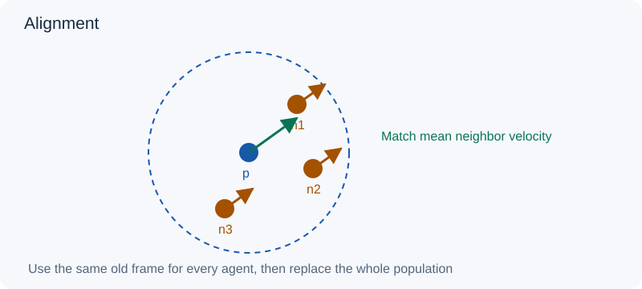

# Alignment — alinhar velocidades / match velocities

[Início / Home](Home.md) · [Fundamentos / Foundations](Foundations.md)

## Intuição / Intuition

Observe para onde e quão rápido os vizinhos vão. Alignment tenta reproduzir a velocidade média deles, incluindo o módulo. Isso é diferente de apenas alinhar a orientação de um sprite.

**English.** Match the average neighbor velocity, including speed. This is velocity alignment rather than merely rotating a visual sprite.



Diagrama esquemático, sem escala. Azul: agente/velocidade; laranja: alvo/geometria;
verde: decisão desejada. Setas representam grandezas distintas, não uma trajetória calculada.
Schematic, not to scale. Blue: agent/velocity; orange: target/geometry; green: desired decision.
Arrows represent different quantities, not a simulated trajectory.

## Passo a passo / Pseudocode

Notação e funções auxiliares: [Fundamentos](Foundations.md). O resultado `a` é
aceleração; apenas o engine integra a posição. This is implementation-oriented
pseudocode, with helpers defined in Foundations; the engine integrates the result.

```text
N = neighborsFor(originalAgent, radius=R)
if N is empty: return (0, 0)
u = limit(mean(other.velocity for other in N), V)
return limit((u - v)/T, A)
```

## Parâmetros / Parameters

| Entrada / Input | Efeito e ajuste / Effect and tuning |
| --- | --- |
| `radius = 80` | Alcance da observação / observation radius. |
| `responseTime = 0.25` | T da correção da velocidade / velocity response time. |
| `neighborhood` | Mesmo quadro para todos os agentes / same frame for all agents. |

## Veja em movimento / See it move

[Abra esta cena no laboratório / Open this lab scene](https://kleberandrade.github.io/steering-engine/?mode=Alignment)

Pause, avance um passo e compare os vetores com o diagrama acima.
Pause, single-step and compare the vectors with the diagram above.

## Uso em Dart / Dart usage

Importe `package:steering_engine/steering_engine.dart`. Os trechos abaixo mostram
a configuração; `agent`, `dt`, `agents` e `targetSnapshot`, quando usados, são
snapshots do quadro atual. Veja o [loop completo](Foundations.md).
Import the public package; these are configuration snippets in the complete loop
from Foundations, using current-frame snapshots where applicable.

```dart
final observed = AgentNeighborhood(agents);
final behavior = Alignment(observed, radius: 80, responseTime: 0.25);
```

## Experimente / Try it

Vizinhos com v=(4,0) e v=(0,4) dão média=(2,2). Com vAgente=(0,0), T=0.5 e A=20, a=(4,4). / The mean velocity is (2,2), so acceleration is (4,4).

## Limites e diagnóstico / Limits and troubleshooting

Sem vizinhos retorna zero, não Brake. Vizinhos com velocidades opostas podem produzir média zero e frenagem. Em Flutter, use prefixo de import para evitar conflito com o widget Alignment. / Empty neighborhoods do not brake; opposite velocities can cancel. Use an import prefix in Flutter.

## Implementação e leitura / Implementation and reading

- [Código / Source](https://github.com/kleberandrade/steering-engine/blob/main/lib/src/behaviors/group/alignment.dart)
- [Separation](Separation.md) · [Cohesion](Cohesion.md) · [Flocking](Flocking.md)
- [Receitas e diagnóstico / Recipes and troubleshooting](Recipes.md)

As fórmulas descrevem esta biblioteca, que adapta os conceitos de Reynolds.
These formulas describe this implementation; conceptual references are listed on [Home](Home.md).
