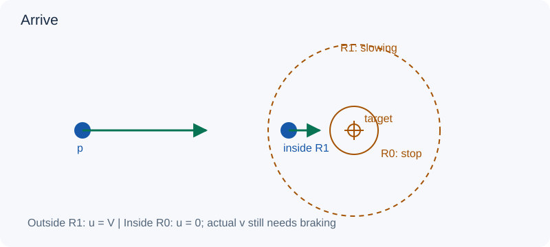

# Arrive — chegar e frear / arrive and slow down

[Início / Home](Home.md) · [Fundamentos / Foundations](Foundations.md)

## Intuição / Intuition

Para estacionar perto de um ponto, correr até ele não basta. Arrive reduz a velocidade desejada conforme a distância cai. Fora do raio de desaceleração pede V; dentro do raio de parada pede zero e continua aplicando frenagem limitada.

**English.** To park near a point, reduce desired speed with distance. Beyond the slowing radius request V; inside the stop radius request zero. Actual velocity still changes through bounded braking.



Diagrama esquemático, sem escala. Azul: agente/velocidade; laranja: alvo/geometria;
verde: decisão desejada. Setas representam grandezas distintas, não uma trajetória calculada.
Schematic, not to scale. Blue: agent/velocity; orange: target/geometry; green: desired decision.
Arrows represent different quantities, not a simulated trajectory.

## Passo a passo / Pseudocode

Notação e funções auxiliares: [Fundamentos](Foundations.md). O resultado `a` é
aceleração; apenas o engine integra a posição. This is implementation-oriented
pseudocode, with helpers defined in Foundations; the engine integrates the result.

```text
offset = target - p
d = length(offset)
fraction = clamp((d - stopRadius) / (slowingRadius - stopRadius), 0, 1)
u = normalize(offset) * V * fraction
return limit((u - v) / T, A)
```

## Parâmetros / Parameters

| Entrada / Input | Efeito e ajuste / Effect and tuning |
| --- | --- |
| `slowingRadius = 100` | R1: início da redução; aumente se ultrapassar / increase to begin slowing earlier. |
| `stopRadius = 1` | R0: velocidade desejada zero, sem teletransporte / zero desired speed, no snapping. |
| `responseTime = 0.25` | T positivo / positive T; R1 > R0 >= 0. |

## Veja em movimento / See it move

[Abra esta cena no laboratório / Open this lab scene](https://kleberandrade.github.io/steering-engine/?mode=Arrive)

Pause, avance um passo e compare os vetores com o diagrama acima.
Pause, single-step and compare the vectors with the diagram above.

## Uso em Dart / Dart usage

Importe `package:steering_engine/steering_engine.dart`. Os trechos abaixo mostram
a configuração; `agent`, `dt`, `agents` e `targetSnapshot`, quando usados, são
snapshots do quadro atual. Veja o [loop completo](Foundations.md).
Import the public package; these are configuration snippets in the complete loop
from Foundations, using current-frame snapshots where applicable.

```dart
final behavior = Arrive(Vec2(200, 100),
    slowingRadius: 80, stopRadius: 2, responseTime: 0.25);
```

## Experimente / Try it

Para d=26, R0=2, R1=50 e V=12: fraction=24/48=0.5, velocidade desejada=6. Já dentro de R0, com v=(4,0), T=0.5 e A=20, a=(-8,0). / Desired speed at d=26 is 6; inside R0 braking remains finite.

## Limites e diagnóstico / Limits and troubleshooting

O raio de parada não é uma barreira nem garante posição exata. Passos grandes ou pouco espaço de frenagem causam ultrapassagem. `V²/(2A)` é uma referência de frenagem sob desaceleração constante, não uma garantia deste controlador. / No exact-position or no-overshoot guarantee; use small fixed steps and enough slowing distance.

## Implementação e leitura / Implementation and reading

- [Código / Source](https://github.com/kleberandrade/steering-engine/blob/main/lib/src/behaviors/individual/arrive.dart)
- [Seek](Seek.md) · [Brake](Brake.md) · [Path following](Path-Following.md)
- [Receitas e diagnóstico / Recipes and troubleshooting](Recipes.md)

As fórmulas descrevem esta biblioteca, que adapta os conceitos de Reynolds.
These formulas describe this implementation; conceptual references are listed on [Home](Home.md).
