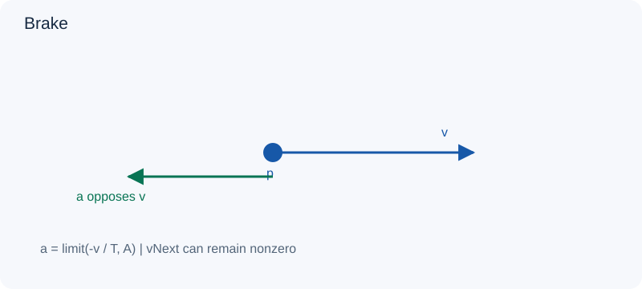

# Brake — frear / brake

[Início / Home](Home.md) · [Fundamentos / Foundations](Foundations.md)

## Intuição / Intuition

Brake tenta reduzir a velocidade a zero, sem escolher destino. A desaceleração cresce com a velocidade e é limitada por A. O agente pode continuar avançando enquanto freia.

**English.** Brake requests zero velocity without selecting a destination. Deceleration depends on current speed and is capped at A; position can keep changing while braking.



Diagrama esquemático, sem escala. Azul: agente/velocidade; laranja: alvo/geometria;
verde: decisão desejada. Setas representam grandezas distintas, não uma trajetória calculada.
Schematic, not to scale. Blue: agent/velocity; orange: target/geometry; green: desired decision.
Arrows represent different quantities, not a simulated trajectory.

## Passo a passo / Pseudocode

Notação e funções auxiliares: [Fundamentos](Foundations.md). O resultado `a` é
aceleração; apenas o engine integra a posição. This is implementation-oriented
pseudocode, with helpers defined in Foundations; the engine integrates the result.

```text
return limit(-v / T, A)
```

## Parâmetros / Parameters

| Entrada / Input | Efeito e ajuste / Effect and tuning |
| --- | --- |
| `responseTime = 0.25` | Menor T aumenta a frenagem até A / smaller T increases braking up to A. |

## Veja em movimento / See it move

[Abra esta cena no laboratório / Open this lab scene](https://kleberandrade.github.io/steering-engine/?mode=Brake)

Pause, avance um passo e compare os vetores com o diagrama acima.
Pause, single-step and compare the vectors with the diagram above.

## Uso em Dart / Dart usage

Importe `package:steering_engine/steering_engine.dart`. Os trechos abaixo mostram
a configuração; `agent`, `dt`, `agents` e `targetSnapshot`, quando usados, são
snapshots do quadro atual. Veja o [loop completo](Foundations.md).
Import the public package; these are configuration snippets in the complete loop
from Foundations, using current-frame snapshots where applicable.

```dart
final behavior = Brake(responseTime: 0.5);
```

## Experimente / Try it

Com v=(10,0), T=0.5, A=8 e dt=0.1, a=(-8,0) e vNext=(9.2,0). / This first step reduces speed to 9.2 rather than setting it to zero.

## Limites e diagnóstico / Limits and troubleshooting

Não cria atrito permanente: quando outro comportamento assumir, a aceleração será a dele. Euler com dt excessivo pode inverter o sinal e oscilar. / No persistent friction; excessive dt can cause reversal and oscillation.

## Implementação e leitura / Implementation and reading

- [Código / Source](https://github.com/kleberandrade/steering-engine/blob/main/lib/src/behaviors/individual/brake.dart)
- [Arrive](Arrive.md) · [Priority steering](Priority-Steering.md)
- [Receitas e diagnóstico / Recipes and troubleshooting](Recipes.md)

As fórmulas descrevem esta biblioteca, que adapta os conceitos de Reynolds.
These formulas describe this implementation; conceptual references are listed on [Home](Home.md).
