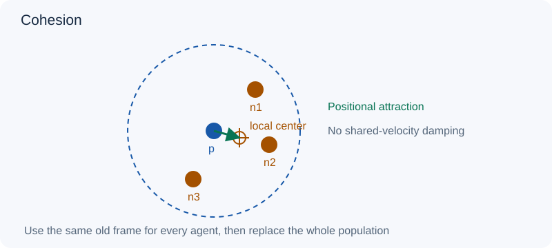

# Cohesion — aproximar o grupo / bring the group together

[Início / Home](Home.md) · [Fundamentos / Foundations](Foundations.md)

## Intuição / Intuition

Cohesion puxa o agente para o centro local dos vizinhos. Aqui a atração é proporcional à distância normalizada, sem subtrair a velocidade comum do grupo. Assim, aproximar não significa frear um grupo que já viaja junto.

**English.** Pull toward the local center of neighbors using distance-scaled positional attraction. This implementation does not subtract common velocity, so cohesion alone does not damp shared travel.



Diagrama esquemático, sem escala. Azul: agente/velocidade; laranja: alvo/geometria;
verde: decisão desejada. Setas representam grandezas distintas, não uma trajetória calculada.
Schematic, not to scale. Blue: agent/velocity; orange: target/geometry; green: desired decision.
Arrows represent different quantities, not a simulated trajectory.

## Passo a passo / Pseudocode

Notação e funções auxiliares: [Fundamentos](Foundations.md). O resultado `a` é
aceleração; apenas o engine integra a posição. This is implementation-oriented
pseudocode, with helpers defined in Foundations; the engine integrates the result.

```text
N = neighborsFor(originalAgent, radius=R)
direction = mean((other.position - p)/R for other in N)
return limit(A * direction, A)
```

## Parâmetros / Parameters

| Entrada / Input | Efeito e ajuste / Effect and tuning |
| --- | --- |
| `radius = 80` | Alcance e escala da atração / query radius and attraction scale. |
| `neighborhood` | Observação imutável compartilhada / shared immutable observation. |

## Veja em movimento / See it move

[Abra esta cena no laboratório / Open this lab scene](https://kleberandrade.github.io/steering-engine/?mode=Cohesion)

Pause, avance um passo e compare os vetores com o diagrama acima.
Pause, single-step and compare the vectors with the diagram above.

## Uso em Dart / Dart usage

Importe `package:steering_engine/steering_engine.dart`. Os trechos abaixo mostram
a configuração; `agent`, `dt`, `agents` e `targetSnapshot`, quando usados, são
snapshots do quadro atual. Veja o [loop completo](Foundations.md).
Import the public package; these are configuration snippets in the complete loop
from Foundations, using current-frame snapshots where applicable.

```dart
final observed = AgentNeighborhood(agents);
final behavior = Cohesion(observed, radius: 80);
```

## Experimente / Try it

Um vizinho a 5 unidades à direita, R=10 e A=20 gera a=(10,0). Sem vizinhos, mean(empty)=zero. / One neighbor yields (10,0); no neighbors yield zero.

## Limites e diagnóstico / Limits and troubleshooting

Não é Seek(centro): não pede velocidade máxima nem faz correção de velocidade. Sem separação o grupo pode se aglomerar; use Flocking para equilibrar as regras. / Not Seek(center); does not match velocity. Pair with Separation to avoid clustering.

## Implementação e leitura / Implementation and reading

- [Código / Source](https://github.com/kleberandrade/steering-engine/blob/main/lib/src/behaviors/group/cohesion.dart)
- [Separation](Separation.md) · [Alignment](Alignment.md) · [Flocking](Flocking.md)
- [Receitas e diagnóstico / Recipes and troubleshooting](Recipes.md)

As fórmulas descrevem esta biblioteca, que adapta os conceitos de Reynolds.
These formulas describe this implementation; conceptual references are listed on [Home](Home.md).
