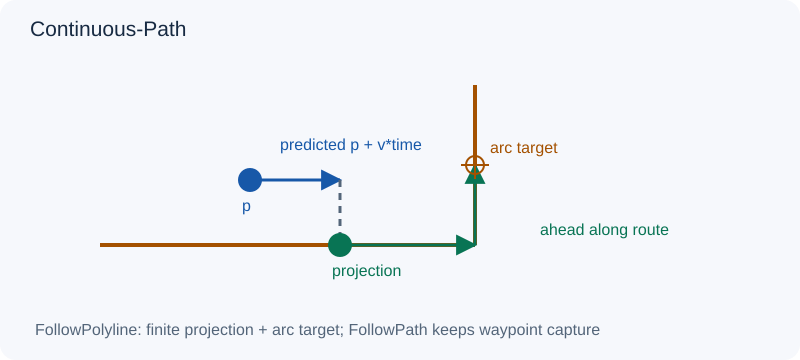

# Continuous path — seguir segmentos / follow segments

[Início / Home](Home.md) · [Fundamentos / Foundations](Foundations.md)

## Intuição / Intuition

Imagine um trilho em vez de uma sequência de bandeiras. O agente projeta uma
posição prevista nesse trilho e mira um ponto adiante pela distância do percurso.
O alvo pode atravessar uma curva mesmo antes do agente chegar nela. `FollowPath`
continua sendo a alternativa por captura de waypoints; `FollowPolyline` é nova.

**English.** Project a predicted position onto a finite polyline, then advance the
target along route arc length. The target can move through a corner before the
agent reaches it. FollowPath retains its original capture-radius semantics;
FollowPolyline is a separate stateful behavior introduced in source 0.2.0.



Azul: agente e previsão; laranja: rota; verde: projeção e avanço pelo percurso.
Diagrama conceitual, sem escala ou trajetória simulada.
Blue: agent/prediction; orange: route; green: projection and arc advance.

## Passo a passo / Pseudocode

```text
geometry = nonzero edges with cumulative lengths, including loop closing edge
predicted = p + v*predictionTime
if first acquisition:
    projection = globally nearest finite-segment projection(predicted)
else:
    projection = nearest projection inside [progress, progress + searchDistance]
    # split at loop seam, at most one lap; retain earliest progress on ties
progress = projection's unwrapped arc distance
currentTarget = pointAt(progress + lookAheadDistance)
speed = V
for each upcoming corner within cornerSlowingDistance:
    c = clamp(dot(incomingTangent, outgoingTangent), -1, 1)
    cornerRatio = minCornerSpeedRatio + (1-minCornerSpeedRatio)*(1+c)/2
    ratio = cornerRatio + (1-cornerRatio)*distanceToCorner/cornerSlowingDistance
    speed = min(speed, V*ratio)
if open-route target has reached the end:
    speed = min(speed, V*clamp((distance(p,end)-stopRadius)/(slowingRadius-stopRadius),0,1))
u = normalize(currentTarget-p)*speed
return limit((u-v)/T, A)
```

Normalização, limites e unidades estão em [Fundamentos](Foundations.md).
Helpers and units are defined in Foundations. Direct `calculate(..., 0)` returns
zero without changing this follower; the engine itself also skips zero-dt evaluation.

## Parâmetros / Parameters

| Entrada / Input | Efeito e ajuste / Effect and tuning |
| --- | --- |
| `PolylinePath(SteeringPath(...))` | Geometria imutável compartilhada / shared immutable geometry; zero-length edges skipped |
| `lookAheadDistance = 30` | Distância do alvo no percurso / arc target distance; larger values can cut corners |
| `predictionTime = 0.2` | Segundos de previsão da posição projetada / seconds of position prediction |
| `searchDistance = 80` | Janela adiante após aquisição / forward progress window after acquisition |
| `cornerSlowingDistance = 40` | Alcance de redução antes de curvas; zero desativa / preview distance; zero disables |
| `minCornerSpeedRatio = 0.35` | Razão em reversão de 180°; reta mantém 1 / reversal ratio; straight edges retain 1 |
| `slowingRadius = 50`, `stopRadius = 1` | Frenagem no alvo final aberto / final arrival speed profile; slowing > stop >= 0 |
| `responseTime = 0.25` | T positivo em segundos / positive velocity response time |

## Veja em movimento / See it move

[Abra esta cena no laboratório / Open this lab scene](https://kleberandrade.github.io/steering-engine/?mode=Continuous%20path)

Compare `Path following` e `Continuous path` na mesma rota. O ponto ciano mostra
a projeção e o alvo dourado mostra o destino adiante. Pause e Step preservam a
observação para inspeção. / Compare the two modes on the same route; cyan marks
the last projection, gold the current target.

## Uso em Dart / Dart usage

Importe o pacote público; preserve uma instância por agente.
Import the public package and retain one follower per agent:

```dart
final geometry = PolylinePath(SteeringPath([
  Vec2(0, 0), Vec2(100, 0), Vec2(100, 100),
]));
final behavior = FollowPolyline(geometry,
    lookAheadDistance: 30, predictionTime: 0.2, searchDistance: 80);
```

`progress` é monotônico, sem envolver nas voltas; `lapCount` conta voltas.
`lastProjection` e `currentTarget` são leituras sem mutação. `reset()` limpa o
estado e a próxima chamada positiva adquire globalmente. `reacquire(agent)`
projeta a posição real globalmente e reinicia a contagem de voltas, sem previsão.

Progress is monotonic and unwrapped. After a teleport, explicitly call reacquire;
reset instead clears state for a fresh global acquisition on the next step.
Neither method changes the agent. Shared geometry does not share progress.

## Experimente / Try it

Na rota (0,0) → (100,0) → (100,100), a projeção de (60,20) é (60,0), distância
acumulada 60. Avançar 60 unidades gera alvo (100,20), não (120,0).
For this L-route, arc-length advance crosses the vertex rather than extending
the first segment indefinitely.

Execute `dart run example/polyline_following.dart`. Na cena fixa com V=40, A=100,
dt=1/60, 2400 passos e look-ahead=15, a medição VM registrou:
Run the example; its fixed L-route fixture recorded these VM results:

| Métrica / Metric | Sem redução / Disabled | Preview 35 |
| --- | --- | --- |
| Maior velocidade dentro de 20 unidades da curva / peak corner-neighborhood speed | 39.9721 | 37.7693 |
| Maior distância à polilinha / maximum route distance | 4.8020 | 4.9133 |
| Distância final ao destino / final destination distance | 0.9752 | 0.9748 |

A redução de velocidade não melhorou o erro máximo nesta cena. É um ganho
configurável, não garantia de trajetória melhor. O CLI verifica a redução e a
chegada nas duas configurações; JS também é exercitado no CI.
The speed cap did not improve maximum tracking error in this fixture. Treat it
as a configurable control policy, not a universal trajectory improvement.

## Limites e diagnóstico / Limits and troubleshooting

Rotas precisam de pelo menos uma aresta não nula; pontos consecutivos repetidos
são ignorados apenas na geometria contínua. Listas só de pontos coincidentes
são rejeitadas; FollowPath continua aceitando destino único.

A janela local limita saltos para ramos distantes, mas não garante desambiguar
ramos próximos dentro da própria janela. Empates preservam a ordem mais cedo.
Teletransportes exigem reacquire; marcha a ré não reduz o progresso normal.
A busca de geometria é linear no número de segmentos. A grade de vizinhos não
acelera esta consulta.

At least one nonzero edge is required. Local progress windows limit distant
branch jumps, not every ambiguity in self-intersections. Teleports require
explicit reacquisition; backward motion does not rewind normal progress.
Geometry queries scan segments linearly. No splines, curvature constraints,
collision resolution, exact line tracking or vehicle dynamics are implied.

## Implementação e leitura / Implementation and reading

- [Código / Source](https://github.com/kleberandrade/steering-engine/blob/main/lib/src/navigation/follow_polyline.dart)
- [Geometria / Geometry](https://github.com/kleberandrade/steering-engine/blob/main/lib/src/navigation/polyline_path.dart)
- [Path following](Path-Following.md) · [Receitas / Recipes](Recipes.md)
- [0.2.0 engineering record](../roadmap_0.2.0.md)
