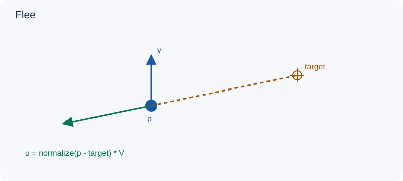

# Flee — fugir / escape

[Início / Home](Home.md) · [Fundamentos / Foundations](Foundations.md)

## Intuição / Intuition

Agora a bandeira é uma ameaça. Inverta a direção de Seek para solicitar movimento para longe dela. A aceleração ainda precisa vencer a velocidade atual: um agente que vinha correndo na direção da ameaça não inverte instantaneamente.

**English.** Invert the Seek direction to escape a fixed threat. Steering must first overcome current velocity, so a character moving toward the threat cannot reverse instantaneously.



Diagrama esquemático, sem escala. Azul: agente/velocidade; laranja: alvo/geometria;
verde: decisão desejada. Setas representam grandezas distintas, não uma trajetória calculada.
Schematic, not to scale. Blue: agent/velocity; orange: target/geometry; green: desired decision.
Arrows represent different quantities, not a simulated trajectory.

## Passo a passo / Pseudocode

Notação e funções auxiliares: [Fundamentos](Foundations.md). O resultado `a` é
aceleração; apenas o engine integra a posição. This is implementation-oriented
pseudocode, with helpers defined in Foundations; the engine integrates the result.

```text
offset = p - threat
u = normalize(offset) * V
return limit((u - v) / T, A)
```

## Parâmetros / Parameters

| Entrada / Input | Efeito e ajuste / Effect and tuning |
| --- | --- |
| `target` | Posição da ameaça / fixed threat position. |
| `responseTime = 0.25` | Tempo de correção da velocidade / velocity response time. |

## Veja em movimento / See it move

[Abra esta cena no laboratório / Open this lab scene](https://kleberandrade.github.io/steering-engine/?mode=Flee)

Pause, avance um passo e compare os vetores com o diagrama acima.
Pause, single-step and compare the vectors with the diagram above.

## Uso em Dart / Dart usage

Importe `package:steering_engine/steering_engine.dart`. Os trechos abaixo mostram
a configuração; `agent`, `dt`, `agents` e `targetSnapshot`, quando usados, são
snapshots do quadro atual. Veja o [loop completo](Foundations.md).
Import the public package; these are configuration snippets in the complete loop
from Foundations, using current-frame snapshots where applicable.

```dart
final behavior = Flee(Vec2(100, 0));
```

## Experimente / Try it

Use os valores do exemplo Seek: a=(-20,0), vNext=(-2,0), pNext=(-0.2,0). Em seguida inicie v=(10,0) para observar o tempo de reversão. / Start with positive X velocity to observe bounded reversal.

## Limites e diagnóstico / Limits and troubleshooting

Não há raio de ativação: Flee continua fugindo mesmo longe. Sobreposição exata retorna velocidade desejada zero; não escolhe saída aleatória. Para ameaças móveis veja Evade. / No activation radius; exact overlap has no escape direction. Use Evade for moving threats.

## Implementação e leitura / Implementation and reading

- [Código / Source](https://github.com/kleberandrade/steering-engine/blob/main/lib/src/behaviors/individual/flee.dart)
- [Seek](Seek.md) · [Evade](Evade.md)
- [Receitas e diagnóstico / Recipes and troubleshooting](Recipes.md)

As fórmulas descrevem esta biblioteca, que adapta os conceitos de Reynolds.
These formulas describe this implementation; conceptual references are listed on [Home](Home.md).
