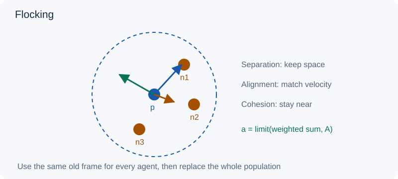

# Flocking — movimento coletivo / flocking

[Início / Home](Home.md) · [Fundamentos / Foundations](Foundations.md)

## Intuição / Intuition

O bando surge de três decisões locais: manter espaço, alinhar velocidade e ficar perto. Flocking combina essas regras por pesos. Todos devem enxergar o mesmo quadro antigo antes de substituir a população inteira.

**English.** Flocks emerge from separation, alignment and cohesion. Weighted local decisions must read the same old frame; replace the whole population only after calculating all new snapshots.



Diagrama esquemático, sem escala. Azul: agente/velocidade; laranja: alvo/geometria;
verde: decisão desejada. Setas representam grandezas distintas, não uma trajetória calculada.
Schematic, not to scale. Blue: agent/velocity; orange: target/geometry; green: desired decision.
Arrows represent different quantities, not a simulated trajectory.

## Passo a passo / Pseudocode

Notação e funções auxiliares: [Fundamentos](Foundations.md). O resultado `a` é
aceleração; apenas o engine integra a posição. This is implementation-oriented
pseudocode, with helpers defined in Foundations; the engine integrates the result.

```text
observed = AgentNeighborhood(oldAgents)  # once per frame
rule = WeightedBlend([
    (Separation(observed, separationRadius), separationWeight),
    (Alignment(observed, neighborRadius, T), alignmentWeight),
    (Cohesion(observed, neighborRadius), cohesionWeight)
])
nextAgents = [engine.step(agent, rule, dt) for agent in oldAgents]
agents = nextAgents
```

## Parâmetros / Parameters

| Entrada / Input | Efeito e ajuste / Effect and tuning |
| --- | --- |
| `separationRadius = 25`, `neighborRadius = 80` | Separação próxima e observação mais ampla / near repulsion and broader interaction. |
| `separationWeight = 1.5` | Ganho da repulsão / repulsion gain. |
| `alignmentWeight = 1`, `cohesionWeight = 1` | Ganhos sem normalização / unnormalized gains. |
| `responseTime = 0.25` | Tempo de resposta de Alignment / alignment response time. |

## Veja em movimento / See it move

[Abra esta cena no laboratório / Open this lab scene](https://kleberandrade.github.io/steering-engine/?mode=Flocking)

Pause, avance um passo e compare os vetores com o diagrama acima.
Pause, single-step and compare the vectors with the diagram above.

## Uso em Dart / Dart usage

Importe `package:steering_engine/steering_engine.dart`. Os trechos abaixo mostram
a configuração; `agent`, `dt`, `agents` e `targetSnapshot`, quando usados, são
snapshots do quadro atual. Veja o [loop completo](Foundations.md).
Import the public package; these are configuration snippets in the complete loop
from Foundations, using current-frame snapshots where applicable.

```dart
final observed = AgentNeighborhood.spatial(agents, cellSize: 80);
final behavior = Flocking(observed,
    separationWeight: 1.5, alignmentWeight: 1, cohesionWeight: 0.7);
final next = [
  for (final agent in agents)
    const SteeringEngine().step(agent, behavior, 1 / 60),
];
// Substitua agents por next apenas após o cálculo completo. / Replace after the batch.
```

## Experimente / Try it

Comece com apenas Separation e ative as outras regras uma a uma. Se virar uma bola compacta, reduza cohesionWeight ou aumente separação. / Enable rules individually; reduce cohesion or increase separation if the group collapses.

## Limites e diagnóstico / Limits and troubleshooting

Os pesos não são probabilidades e não somam obrigatoriamente 1. Não há destino global nem garantia de colisão evitada. Consultas lineares custam O(n²) no grupo; a grade ajuda em cenas esparsas, sem garantia no pior caso. / No global goal, collision guarantee or universal grid speedup.

## Implementação e leitura / Implementation and reading

- [Código / Source](https://github.com/kleberandrade/steering-engine/blob/main/lib/src/behaviors/group/flocking.dart)
- [Spatial index](Spatial-Index.md) · [Weighted blend](Weighted-Blend.md)
- [Receitas e diagnóstico / Recipes and troubleshooting](Recipes.md)

As fórmulas descrevem esta biblioteca, que adapta os conceitos de Reynolds.
These formulas describe this implementation; conceptual references are listed on [Home](Home.md).
