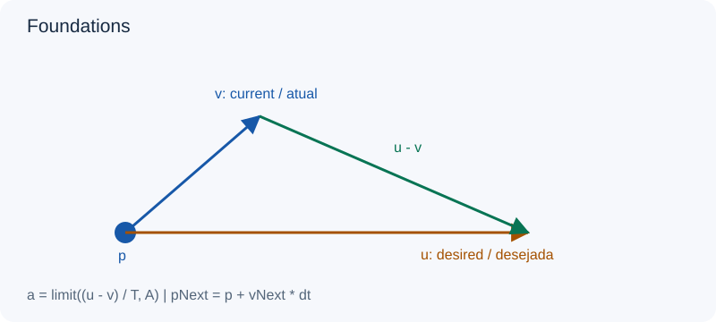

# Fundamentos / Foundations

[Início / Home](Home.md)

## De intenção a movimento / From intention to motion

“Vá até a bandeira” é um objetivo. Steering transforma esse objetivo em uma
**aceleração**; o integrador transforma aceleração em velocidade e posição.
O desenho só lê o resultado. Uma seta apontando para o alvo não é a velocidade
real: se o agente já corre em outra direção, precisa de tempo para mudar.

**English.** A goal becomes acceleration through steering. The integrator then
updates velocity and position; rendering reads the result. Desired velocity is
not actual velocity: turning takes time when acceleration is bounded.



Azul: velocidade atual; laranja: velocidade desejada; verde: correção.
Blue: current velocity; orange: desired velocity; green: correction.
Diagrama conceitual, sem escala / conceptual diagram, not to scale.

## Glossário e unidades / Glossary and units

| Símbolo / Symbol | Português | English | Unidade / Unit |
| --- | --- | --- | --- |
| `p` | posição atual | current position | distância / distance |
| `v` | velocidade atual, vetor | current velocity vector | distância/s |
| `u` | velocidade desejada | desired velocity | distância/s |
| `a` | aceleração solicitada | requested acceleration | distância/s² |
| `V` | `agent.maxSpeed`, limite de rapidez | speed magnitude cap | distância/s |
| `A` | `agent.maxAcceleration`, limite de aceleração | acceleration magnitude cap | distância/s² |
| `T` | tempo de resposta positivo | positive response time | segundos / seconds |
| `dt` | duração de um passo | step duration | segundos / seconds |
| `R` | raio de interação | interaction radius | distância / distance |
| snapshot | observação imutável de um instante | immutable observation of one instant | — |
| heading | direção da velocidade, quando não nula | direction of nonzero velocity | vetor unitário / unit vector |

Você escolhe distância em pixels, metros ou outra unidade; use a mesma em
posições, raios e limites. Não passe milissegundos como segundos. A saída não é
força: não existe massa no núcleo. `a = força / massa` só pertence a um modelo
físico externo, caso você o implemente.

Choose pixels, meters or another distance unit consistently. Convert milliseconds
to seconds before stepping. Outputs are acceleration, not force; the core has no
mass or vehicle model.

## Funções usadas no pseudocódigo / Pseudocode helpers

```text
length(x)          = Euclidean magnitude of vector x
normalize(x)       = x / length(x), or zero if x is zero
limit(x, m)        = x if length(x) <= m; otherwise normalize(x)*m
clamp(x, low, hi)  = min(hi, max(low, x))
dot(x, y)         = x.x*y.x + x.y*y.y
mean(values)      = vector average; zero for an empty list
distance(p, q)    = length(q - p)
moving            = length(velocity) > 0
zero              = (0, 0)
```

Os passos omitem validações para destacar a decisão. O código exige números
finitos, limites não negativos, tempos de resposta positivos e geometria válida.
Erro de configuração gera `ArgumentError`, mesmo sem asserts. Os algoritmos
usam vetores e snapshots; `originalAgent` significa a própria instância que está
na observação, sem reconstruí-la antes da consulta.

Pseudocode omits validation for clarity. Runtime code rejects nonfinite or
invalid parameters. `originalAgent` means the same instance present in the
neighborhood; identity excludes self, not equal position or equal field values.

## Um loop completo e executável / A complete runnable loop

Com a dependência configurada conforme o README, salve como `example/arrival.dart`
e execute `dart run example/arrival.dart`. Não recrie o agente antes de cada passo:
o próximo snapshot precisa carregar a velocidade calculada.

With the dependency configured as in the README, save this as
`example/arrival.dart` and run it. Carry the returned snapshot into the next step.

```dart
import 'package:steering_engine/steering_engine.dart';

void main() {
  const engine = SteeringEngine();
  const dt = 1 / 60;
  var agent = SteeringAgent(
    position: Vec2.zero,
    maxSpeed: 80,
    maxAcceleration: 160,
  );
  final behavior = Arrive(Vec2(200, 100), slowingRadius: 80);
  for (var frame = 0; frame < 600; frame++) {
    agent = engine.step(agent, behavior, dt);
  }
  print(agent.position);
}
```

O integrador é Euler semi-implícito: primeiro atualiza a velocidade, depois usa
essa nova velocidade para deslocar a posição. Não existem colisões, atrito ou
subpassos automáticos. `dt == 0` retorna o mesmo agente sem avaliar a regra.

Semi-implicit Euler updates velocity before position. The engine does not add
collisions, friction or automatic substeps. Zero dt returns the identical
snapshot without evaluating the behavior.

```text
if dt == 0: return agent
a = limit(behavior.calculate(agent, dt), A)
vNext = limit(v + a*dt, V)
pNext = p + vNext*dt
return new immutable snapshot(pNext, vNext, V, A)
```

Exemplo: p=(0,0), v=(0,0), a=(20,0), dt=0.1 resulta em
vNext=(2,0), pNext=(0.2,0), se os limites não cortarem esses valores.
Example: the new velocity is used for the same step’s displacement.

## Quem guarda estado? / Who retains state?

| Objeto / Object | Ciclo de vida / Lifetime |
| --- | --- |
| `SteeringAgent`, `Vec2` | Imutáveis; substitua pelo retorno / immutable; replace with returned state |
| `Wander` | Uma instância por agente, preservada / retain one instance per agent |
| `FollowPath` | Um índice por agente; preserve a instância / retain each agent’s traversal state |
| `Pursuit`, `Evade`, `LeaderFollowing` | Recrie quando o snapshot do alvo mudar / rebuild with new target observation |
| `AgentNeighborhood`, regras de grupo e `QueueFollowing` | Recrie a partir do mesmo quadro antigo / rebuild from the shared old frame |
| `WeightedBlend`, `PrioritySteering` | Preservam referências aos filhos; o ciclo depende deles / retain child references and their lifetimes |

Regras de grupo precisam de atualização simultânea. Nunca substitua `agents[i]`
enquanto os seguintes ainda consultam a observação antiga e parte da lista nova.
O padrão completo está em [Flocking](Flocking.md).

Group rules require synchronous updates: calculate the entire next list from the
same old observation, then replace it. See the Flocking chapter for the pattern.

## Tela e coordenadas / Screen coordinates

O núcleo não define “cima”. Em Flutter, X normalmente cresce para a direita e Y
para baixo. A normal `(-ty, tx)` de uma tangente `(1,0)` é `(0,1)`; na tela ela
aparece para baixo. `WallSide.left` usa essa definição algébrica, não a esquerda
visual do canvas. Transforme as coordenadas ao desenhar se preferir Y para cima.

The core has no screen-up convention. Flutter canvas Y normally points down;
the algebraic left normal can therefore appear on the visual right. Transform
coordinates in rendering if you prefer a world with upward Y.

Continue por [Seek](Seek.md), [Arrive](Arrive.md) e [Receitas](Recipes.md).
