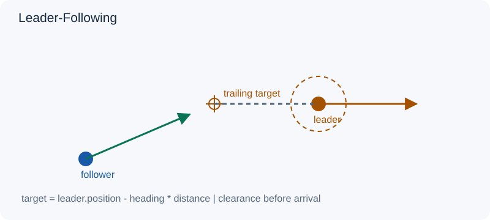

# Leader following — seguir líder / follow a leader

[Início / Home](Home.md) · [Fundamentos / Foundations](Foundations.md)

## Intuição / Intuition

Não persiga o centro do líder: isso faz os dois se encontrarem. Calcule um alvo atrás da direção do líder e chegue nele com Arrive. O afastamento do líder tem prioridade sobre a aproximação.

**English.** Place an arrival target behind the leader’s heading instead of seeking its center. Local leader clearance takes priority over arrival at that trailing target.



Diagrama esquemático, sem escala. Azul: agente/velocidade; laranja: alvo/geometria;
verde: decisão desejada. Setas representam grandezas distintas, não uma trajetória calculada.
Schematic, not to scale. Blue: agent/velocity; orange: target/geometry; green: desired decision.
Arrows represent different quantities, not a simulated trajectory.

## Passo a passo / Pseudocode

Notação e funções auxiliares: [Fundamentos](Foundations.md). O resultado `a` é
aceleração; apenas o engine integra a posição. This is implementation-oriented
pseudocode, with helpers defined in Foundations; the engine integrates the result.

```text
h = normalize(leader.velocity) if moving else normalize(fallbackDirection)
target = leader.position - h*distance
arrival = Arrive(target, slowingRadius, stopRadius, T)
if originalAgent is leader: return zero
if avoidanceRadius == 0: return arrival.calculate(agent, dt)
avoid = ObstacleAvoidance([Circle(leader.position, avoidanceRadius)],
                          safetyMargin=0, minLookAhead=2*avoidanceRadius)
return PrioritySteering([avoid, arrival]).calculate(agent, dt)
```

## Parâmetros / Parameters

| Entrada / Input | Efeito e ajuste / Effect and tuning |
| --- | --- |
| `distance = 40` | Distância atrás do líder; > avoidanceRadius / trailing distance. |
| `avoidanceRadius = 15` | Exclusão local; zero desativa / local exclusion; zero disables. |
| `fallbackDirection = (1,0)` | Direção se o líder parar / heading when stationary. |
| `slowingRadius = 60`, `stopRadius = 1`, `responseTime = 0.25` | Configuração de Arrive / arrival settings. |

## Uso em Dart / Dart usage

Importe `package:steering_engine/steering_engine.dart`. Os trechos abaixo mostram
a configuração; `agent`, `dt`, `agents` e `targetSnapshot`, quando usados, são
snapshots do quadro atual. Veja o [loop completo](Foundations.md).
Import the public package; these are configuration snippets in the complete loop
from Foundations, using current-frame snapshots where applicable.

```dart
final behavior = LeaderFollowing(targetSnapshot,
    distance: 40, avoidanceRadius: 15);
// Recrie quando o líder mudar. / Rebuild for the new leader snapshot.
```

## Experimente / Try it

Líder=(100,50), velocidade=(10,0), distance=40: alvo=(60,50). Se girar para +Y, alvo=(100,10). / Observe how the trailing target rotates with the leader heading.

## Limites e diagnóstico / Limits and troubleshooting

Não guarda a última direção do líder automaticamente: forneça fallbackDirection se precisar. Não organiza formação ou fila entre vários seguidores. A exclusão é local, não uma garantia de segurança. / No automatic heading history, formation assignment or collision guarantee.

## Implementação e leitura / Implementation and reading

- [Código / Source](https://github.com/kleberandrade/steering-engine/blob/main/lib/src/navigation/leader_following.dart)
- [Arrive](Arrive.md) · [Queue following](Queue-Following.md)
- [Receitas e diagnóstico / Recipes and troubleshooting](Recipes.md)

As fórmulas descrevem esta biblioteca, que adapta os conceitos de Reynolds.
These formulas describe this implementation; conceptual references are listed on [Home](Home.md).
