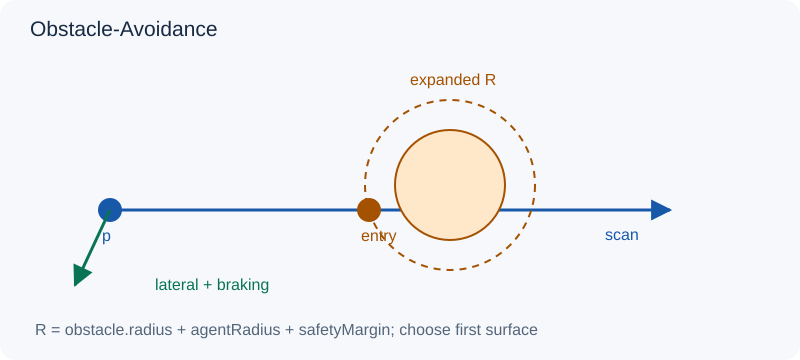

# Obstacle avoidance — desviar de círculos / avoid circles

[Início / Home](Home.md) · [Fundamentos / Foundations](Foundations.md)

## Intuição / Intuition

Olhe à frente antes de colidir. Expanda cada obstáculo pelo raio do agente e pela margem de segurança; assim basta testar o centro do agente contra círculos maiores. Escolha a superfície de entrada mais próxima no raio de visão, não o centro mais próximo.

**English.** Inflate each obstacle by agent radius and safety margin. Scan forward and choose the earliest circle-surface entry, not the nearest center. Respond sideways with a braking component; overlap instead uses outward escape.



Diagrama esquemático, sem escala. Azul: agente/velocidade; laranja: alvo/geometria;
verde: decisão desejada. Setas representam grandezas distintas, não uma trajetória calculada.
Schematic, not to scale. Blue: agent/velocity; orange: target/geometry; green: desired decision.
Arrows represent different quantities, not a simulated trajectory.

## Passo a passo / Pseudocode

Notação e funções auxiliares: [Fundamentos](Foundations.md). O resultado `a` é
aceleração; apenas o engine integra a posição. This is implementation-oriented
pseudocode, with helpers defined in Foundations; the engine integrates the result.

```text
h = normalize(v)
s = (-h.y, h.x)
scan = max(minLookAhead, length(v)*lookAheadTime)
for circle in obstacles:
    R = circle.radius + agentRadius + safetyMargin
    offset = circle.center - p
    if length(offset) <= R: candidate(entry=0, overlap=true); continue
    if h == zero: continue
    lateral = dot(offset, s)
    if abs(lateral) > R: continue
    entry = dot(offset, h) - R*sqrt(max(0, 1-(lateral/R)^2))
    if 0 <= entry <= scan: candidate(entry, overlap=false)
threat = candidate with smallest entry  # first input wins ties
if no threat: return zero
h = (1,0) if v == zero else normalize(v); s = (-h.y, h.x)
if overlap:
    away = p - threat.center
    return A * (s if away == zero else normalize(away))
turn = -s if dot(threat.center-p, s) > 0 else s
return limit(A * normalize(turn - h*brakingWeight), A)
```

## Parâmetros / Parameters

| Entrada / Input | Efeito e ajuste / Effect and tuning |
| --- | --- |
| `agentRadius = 0`, `safetyMargin = 2` | Inflação geométrica / geometric inflation. |
| `lookAheadTime = 1`, `minLookAhead = 40` | Alcance maior entre previsão e mínimo / maximum of predicted and minimum scan. |
| `brakingWeight = 0.5` | Componente de frenagem relativa à lateral / braking relative to lateral steering. |
| `obstacles` | Círculos estáticos copiados / copied static circle geometry. |

## Uso em Dart / Dart usage

Importe `package:steering_engine/steering_engine.dart`. Os trechos abaixo mostram
a configuração; `agent`, `dt`, `agents` e `targetSnapshot`, quando usados, são
snapshots do quadro atual. Veja o [loop completo](Foundations.md).
Import the public package; these are configuration snippets in the complete loop
from Foundations, using current-frame snapshots where applicable.

```dart
final avoidance = ObstacleAvoidance([
  CircleObstacle(Vec2(80, 0), radius: 15),
], agentRadius: 5, safetyMargin: 4, lookAheadTime: 1.5);
final behavior = PrioritySteering([avoidance, Arrive(Vec2(180, 0))]);
```

## Experimente / Try it

Círculo=(50,0), raio=10, agentRadius=2, margem=3: R=15 e entrada=35 para h=(1,0). Com scan=40 é ameaça. Veja findThreat(agent) sem alterar o estado. / Expanded radius is 15 and entry distance 35; read-only threat inspection can draw the scan.

## Limites e diagnóstico / Limits and troubleshooting

Parado só detecta sobreposição; tangência conta como ameaça. Na linha central escolhe +s, que com +X é +Y; em canvas isso aparece para baixo. É heurística reativa para círculos estáticos, sem resolução ou garantia de colisões. / Stationary agents only detect overlap; no collision solver or moving-obstacle prediction.

## Implementação e leitura / Implementation and reading

- [Código / Source](https://github.com/kleberandrade/steering-engine/blob/main/lib/src/navigation/obstacle_avoidance.dart)
- [Priority steering](Priority-Steering.md) · [Leader following](Leader-Following.md)
- [Receitas e diagnóstico / Recipes and troubleshooting](Recipes.md)

As fórmulas descrevem esta biblioteca, que adapta os conceitos de Reynolds.
These formulas describe this implementation; conceptual references are listed on [Home](Home.md).
