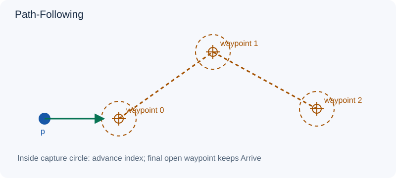

# Path following — seguir waypoints / follow waypoints

[Início / Home](Home.md) · [Fundamentos / Foundations](Foundations.md)

## Intuição / Intuition

Uma rota é uma lista ordenada de destinos. O seguidor guarda qual é o atual, avança quando entra no raio de captura e usa Arrive para se aproximar de cada ponto. Na rota aberta mantém o destino final; na fechada volta ao início.

**English.** A route is an ordered waypoint list. The follower retains its current index, advances inside the capture radius, and uses Arrive at each local destination. Open routes retain the last point; loops wrap to the first.



Diagrama esquemático, sem escala. Azul: agente/velocidade; laranja: alvo/geometria;
verde: decisão desejada. Setas representam grandezas distintas, não uma trajetória calculada.
Schematic, not to scale. Blue: agent/velocity; orange: target/geometry; green: desired decision.
Arrows represent different quantities, not a simulated trajectory.

## Passo a passo / Pseudocode

Notação e funções auxiliares: [Fundamentos](Foundations.md). O resultado `a` é
aceleração; apenas o engine integra a posição. This is implementation-oriented
pseudocode, with helpers defined in Foundations; the engine integrates the result.

```text
if dt > 0:
    repeat at most numberOfWaypoints - 1 times:
        if distance(p, currentWaypoint) > waypointRadius: break
        if index is last and not path.loop: break
        index = (index + 1) modulo numberOfWaypoints
return Arrive(currentWaypoint, slowingRadius, stopRadius, T).calculate(agent, dt)
```

## Parâmetros / Parameters

| Entrada / Input | Efeito e ajuste / Effect and tuning |
| --- | --- |
| `path` | SteeringPath não vazio, loop=false por padrão / nonempty immutable route. |
| `waypointRadius = 10` | Captura do próximo destino / next-point capture threshold; > stopRadius. |
| `slowingRadius = 50`, `stopRadius = 1` | Frenagem em cada ponto / arrival at every point; slowing > stop >= 0. |
| `responseTime = 0.25` | T de Arrive / arrival response time. |

## Veja em movimento / See it move

[Abra esta cena no laboratório / Open this lab scene](https://kleberandrade.github.io/steering-engine/?mode=Path%20following)

Pause, avance um passo e compare os vetores com o diagrama acima.
Pause, single-step and compare the vectors with the diagram above.

## Uso em Dart / Dart usage

Importe `package:steering_engine/steering_engine.dart`. Os trechos abaixo mostram
a configuração; `agent`, `dt`, `agents` e `targetSnapshot`, quando usados, são
snapshots do quadro atual. Veja o [loop completo](Foundations.md).
Import the public package; these are configuration snippets in the complete loop
from Foundations, using current-frame snapshots where applicable.

```dart
final route = SteeringPath([Vec2(80, 0), Vec2(80, 80), Vec2(160, 80)]);
final behavior = FollowPath(route, waypointRadius: 5, slowingRadius: 35);
// Preserve behavior entre passos. / Retain behavior across steps.
```

## Experimente / Try it

Observe waypointIndex ao entrar no círculo de captura. Aumente waypointRadius e veja a troca ocorrer mais cedo. Use reset() para retornar ao ponto zero. / Watch earlier transitions with a larger capture radius; reset rewinds traversal.

## Limites e diagnóstico / Limits and troubleshooting

Uma instância por agente. Não projeta no segmento, não encontra a rota mais curta nem suaviza curvas. dt grande pode pular o círculo e deixar o agente voltando. No máximo n-1 trocas por avaliação evita laço infinito em pontos duplicados. / Capture-radius following, not continuous segment projection or pathfinding.

## Implementação e leitura / Implementation and reading

- [Código / Source](https://github.com/kleberandrade/steering-engine/blob/main/lib/src/navigation/follow_path.dart)
- [Arrive](Arrive.md) · [Wall following](Wall-Following.md)
- [Receitas e diagnóstico / Recipes and troubleshooting](Recipes.md)

As fórmulas descrevem esta biblioteca, que adapta os conceitos de Reynolds.
These formulas describe this implementation; conceptual references are listed on [Home](Home.md).
