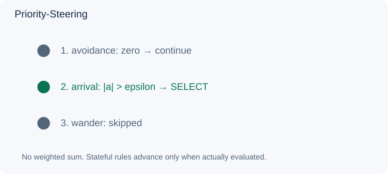

# Priority steering — escolher por prioridade / choose by priority

[Início / Home](Home.md) · [Fundamentos / Foundations](Foundations.md)

## Intuição / Intuition

Algumas decisões devem dominar: desviar de uma ameaça antes de buscar o destino. Avalie as regras na ordem e pare na primeira aceleração cujo módulo supera epsilon. Só uma regra fornece a aceleração daquele passo.

**English.** When avoidance should dominate destination seeking, evaluate rules in order and take the first acceleration above epsilon. Exactly one active rule supplies the output; later rules are not evaluated.



Diagrama esquemático, sem escala. Azul: agente/velocidade; laranja: alvo/geometria;
verde: decisão desejada. Setas representam grandezas distintas, não uma trajetória calculada.
Schematic, not to scale. Blue: agent/velocity; orange: target/geometry; green: desired decision.
Arrows represent different quantities, not a simulated trajectory.

## Passo a passo / Pseudocode

Notação e funções auxiliares: [Fundamentos](Foundations.md). O resultado `a` é
aceleração; apenas o engine integra a posição. This is implementation-oriented
pseudocode, with helpers defined in Foundations; the engine integrates the result.

```text
for behavior in orderedBehaviors:
    a = limit(behavior.calculate(agent, dt), A)
    if length(a) > epsilon: return a
return zero
```

## Parâmetros / Parameters

| Entrada / Input | Efeito e ajuste / Effect and tuning |
| --- | --- |
| `behaviors` | Prioridade maior primeiro; lista copiada / highest priority first, copied list. |
| `epsilon = 0.001` | Limiar finito >= 0 nas unidades de aceleração / nonnegative acceleration threshold. |

## Uso em Dart / Dart usage

Importe `package:steering_engine/steering_engine.dart`. Os trechos abaixo mostram
a configuração; `agent`, `dt`, `agents` e `targetSnapshot`, quando usados, são
snapshots do quadro atual. Veja o [loop completo](Foundations.md).
Import the public package; these are configuration snippets in the complete loop
from Foundations, using current-frame snapshots where applicable.

```dart
final behavior = PrioritySteering([
  ObstacleAvoidance([CircleObstacle(Vec2(80, 0), radius: 15)]),
  Arrive(Vec2(180, 0)),
], epsilon: 0.001);
```

## Experimente / Try it

Saídas com módulos 0, 0.001 e 2, epsilon=0.001: a terceira vence. Igualdade ao limiar não ativa a regra. / Equality does not activate a rule; the third output wins.

## Limites e diagnóstico / Limits and troubleshooting

Não soma forças nem distribui orçamento de aceleração. Uma regra sempre ativa pode impedir todas as seguintes. Evite colocar Wander antes do destino se espera alternância. Regras com estado puladas não avançam. / Always-active rules starve later rules; skipped stateful behaviors do not advance.

## Implementação e leitura / Implementation and reading

- [Código / Source](https://github.com/kleberandrade/steering-engine/blob/main/lib/src/composition/priority_steering.dart)
- [Weighted blend](Weighted-Blend.md) · [Obstacle avoidance](Obstacle-Avoidance.md)
- [Receitas e diagnóstico / Recipes and troubleshooting](Recipes.md)

As fórmulas descrevem esta biblioteca, que adapta os conceitos de Reynolds.
These formulas describe this implementation; conceptual references are listed on [Home](Home.md).
