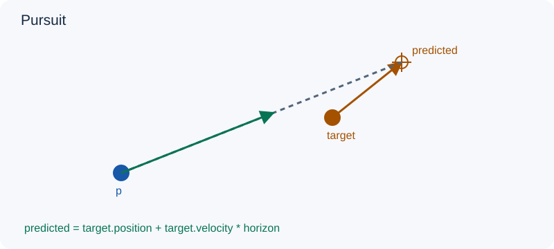

# Pursuit — perseguir / pursue

[Início / Home](Home.md) · [Fundamentos / Foundations](Foundations.md)

## Intuição / Intuition

Em vez de correr atrás da posição antiga do alvo, mire um pouco à frente. A previsão supõe velocidade constante e usa a distância atual para estimar o horizonte. Recrie o comportamento quando receber um novo snapshot do alvo.

**English.** Aim ahead of a moving target using its current velocity. The horizon is estimated from distance and the pursuer’s maximum speed, then capped. Rebuild when the target snapshot changes.



Diagrama esquemático, sem escala. Azul: agente/velocidade; laranja: alvo/geometria;
verde: decisão desejada. Setas representam grandezas distintas, não uma trajetória calculada.
Schematic, not to scale. Blue: agent/velocity; orange: target/geometry; green: desired decision.
Arrows represent different quantities, not a simulated trajectory.

## Passo a passo / Pseudocode

Notação e funções auxiliares: [Fundamentos](Foundations.md). O resultado `a` é
aceleração; apenas o engine integra a posição. This is implementation-oriented
pseudocode, with helpers defined in Foundations; the engine integrates the result.

```text
d = length(target.position - p)
horizon = 0 if V == 0 else min(maxPrediction, d / V)
predicted = target.position + target.velocity * horizon
return Seek(predicted, responseTime=T).calculate(agent, dt)
```

## Parâmetros / Parameters

| Entrada / Input | Efeito e ajuste / Effect and tuning |
| --- | --- |
| `target` | Snapshot imutável do alvo / immutable target snapshot. |
| `maxPrediction = 1` | Horizonte máximo em segundos; zero desativa antecipação / seconds; zero disables prediction. |
| `responseTime = 0.25` | T da regra Seek / underlying velocity response time. |

## Uso em Dart / Dart usage

Importe `package:steering_engine/steering_engine.dart`. Os trechos abaixo mostram
a configuração; `agent`, `dt`, `agents` e `targetSnapshot`, quando usados, são
snapshots do quadro atual. Veja o [loop completo](Foundations.md).
Import the public package; these are configuration snippets in the complete loop
from Foundations, using current-frame snapshots where applicable.

```dart
final behavior = Pursuit(targetSnapshot, maxPrediction: 0.8);
```

## Experimente / Try it

Com alvo=(30,0), vAlvo=(0,4), p=(0,0), V=10 e maxPrediction=2: horizonte=2 e ponto previsto=(30,8). Compare com maxPrediction=0. / The predicted point is (30,8); compare against a zero prediction horizon.

## Limites e diagnóstico / Limits and troubleshooting

Não resolve a equação exata de interceptação e não prevê curvas ou aceleração do alvo. O snapshot não se atualiza sozinho. / Not an exact interception solution; assumes constant velocity and does not update captured snapshots automatically.

## Implementação e leitura / Implementation and reading

- [Código / Source](https://github.com/kleberandrade/steering-engine/blob/main/lib/src/behaviors/individual/pursuit.dart)
- [Pursuit](Pursuit.md) · [Evade](Evade.md) · [Snapshots](Foundations.md)
- [Receitas e diagnóstico / Recipes and troubleshooting](Recipes.md)

As fórmulas descrevem esta biblioteca, que adapta os conceitos de Reynolds.
These formulas describe this implementation; conceptual references are listed on [Home](Home.md).
