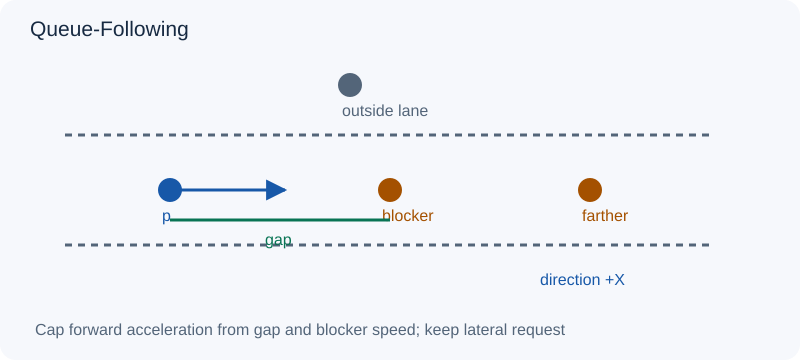

# Queue following — formar fila / spatial queue

[Início / Home](Home.md) · [Fundamentos / Foundations](Foundations.md)

## Intuição / Intuition

Uma fila espacial conserva o movimento desejado, mas limita a aceleração para a frente quando alguém bloqueia a faixa. Primeiro encontra o ocupante estritamente à frente mais próximo; depois calcula a velocidade permitida pela distância disponível.

**English.** Filter a movement rule by limiting forward acceleration behind the nearest lane occupant. Lateral acceleration is preserved before the final magnitude cap, helping the caller retain its own lane-guidance policy.



Diagrama esquemático, sem escala. Azul: agente/velocidade; laranja: alvo/geometria;
verde: decisão desejada. Setas representam grandezas distintas, não uma trajetória calculada.
Schematic, not to scale. Blue: agent/velocity; orange: target/geometry; green: desired decision.
Arrows represent different quantities, not a simulated trajectory.

## Passo a passo / Pseudocode

Notação e funções auxiliares: [Fundamentos](Foundations.md). O resultado `a` é
aceleração; apenas o engine integra a posição. This is implementation-oriented
pseudocode, with helpers defined in Foundations; the engine integrates the result.

```text
requested = limit(movement.calculate(agent, dt), A)
h = normalize(direction); s = (-h.y, h.x)
blocker = nearest neighbor with:
    0 < dot(other.position-p,h) <= lookAhead
    abs(dot(other.position-p,s)) <= laneRadius
if no blocker: return requested
gap = dot(blocker.position-p, h)
u = clamp(dot(blocker.velocity,h) + (gap-spacing)/T, 0, V)
allowed = (u - dot(v,h))/T
current = dot(requested,h)
if current <= allowed: return requested
return limit(requested + h*(allowed-current), A)
```

## Parâmetros / Parameters

| Entrada / Input | Efeito e ajuste / Effect and tuning |
| --- | --- |
| `movement` | Comportamento base obrigatório, avaliado uma vez / required base movement, evaluated once. |
| `direction = (1,0)` | Direção fixa da faixa, não curva automática / fixed lane direction. |
| `spacing = 25`, `laneRadius = 10` | Distância longitudinal entre centros e tolerância lateral / center gap and lateral tolerance. |
| `lookAhead = 100`, `responseTime = 0.25` | Detecção e tempo de resposta / scan and response time. |

## Veja em movimento / See it move

[Abra esta cena no laboratório / Open this lab scene](https://kleberandrade.github.io/steering-engine/?mode=Queue)

Pause, avance um passo e compare os vetores com o diagrama acima.
Pause, single-step and compare the vectors with the diagram above.

## Uso em Dart / Dart usage

Importe `package:steering_engine/steering_engine.dart`. Os trechos abaixo mostram
a configuração; `agent`, `dt`, `agents` e `targetSnapshot`, quando usados, são
snapshots do quadro atual. Veja o [loop completo](Foundations.md).
Import the public package; these are configuration snippets in the complete loop
from Foundations, using current-frame snapshots where applicable.

```dart
final observed = AgentNeighborhood(agents);
final behavior = QueueFollowing(observed,
    movement: Seek(Vec2(300, 0)), spacing: 25, laneRadius: 10);
```

## Experimente / Try it

Com bloqueador parado, gap=spacing=25 e velocidade do agente zero, u=0: a componente de Seek para a frente é cortada e a fila fica parada. / A stopped blocker at desired spacing prevents forward goal creep.

## Limites e diagnóstico / Limits and troubleshooting

É fila no espaço, não estrutura de dados, reserva global ou garantia FIFO. Não detecta quem está exatamente ao lado/na mesma projeção longitudinal. Espaçamento insuficiente e frenagem limitada ainda permitem contato. / Not a task queue or global FIFO policy; no contact resolution.

## Implementação e leitura / Implementation and reading

- [Código / Source](https://github.com/kleberandrade/steering-engine/blob/main/lib/src/navigation/queue_following.dart)
- [Leader following](Leader-Following.md) · [Spatial index](Spatial-Index.md)
- [Receitas e diagnóstico / Recipes and troubleshooting](Recipes.md)

As fórmulas descrevem esta biblioteca, que adapta os conceitos de Reynolds.
These formulas describe this implementation; conceptual references are listed on [Home](Home.md).
