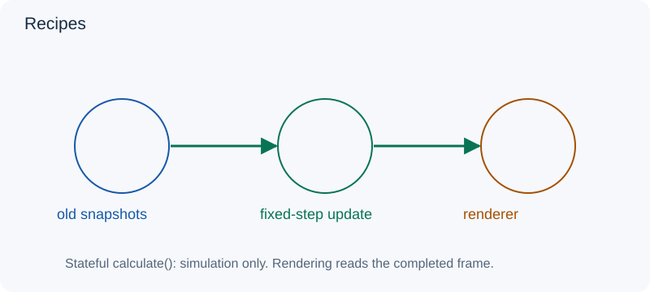

# Receitas e diagnóstico / Recipes and troubleshooting

[Início / Home](Home.md) · [Fundamentos / Foundations](Foundations.md)

## Escolha pelo resultado / Choose by outcome

| Quero / I want | Use | Primeiro ajuste / First adjustment |
| --- | --- | --- |
| Chegar e parar / arrive and stop | Arrive | slowingRadius |
| Correr atrás de alvo móvel / chase a moving target | Pursuit | maxPrediction; atualize o snapshot / refresh the snapshot |
| Explorar / explore | Wander | jitter, distance, radius |
| Patrulhar pontos / patrol waypoints | FollowPath + loop | waypointRadius |
| Contornar círculos / go around circles | PrioritySteering(avoidance, goal) | lookAheadTime, safetyMargin |
| Acompanhar parede / track a wall | WallFollowing | wallOffset, lookAhead |
| Bando / flock | Flocking | separationWeight, depois / then alignment/cohesion |
| Seguir atrás do líder / trail a leader | LeaderFollowing | distance, avoidanceRadius |
| Frear atrás de alguém / brake in a lane | QueueFollowing(movement: goal) | direction, spacing, laneRadius |

## Destino com desvio / Destination with avoidance

```dart
import 'package:steering_engine/steering_engine.dart';

SteeringBehavior destinationWithAvoidance() {
  return PrioritySteering([
    ObstacleAvoidance([
      CircleObstacle(Vec2(80, 0), radius: 15),
    ], agentRadius: 5, safetyMargin: 4, lookAheadTime: 1.5),
    Arrive(Vec2(180, 0), slowingRadius: 40),
  ]);
}
```

O desvio retorna zero sem ameaça e libera a chegada. Se fizer uma média entre
os dois, buscar o alvo pode cancelar a componente lateral do desvio. Prioridade
continua sendo heurística local; não substitui resolução de contato.

Avoidance yields to arrival when no threat exists. A weighted blend can cancel
the lateral avoidance contribution. Priority still does not guarantee safety.

## Do núcleo ao Flutter/Flame / From core to Flutter/Flame



Mantenha um acumulador de tempo e passos de simulação fixos. O esboço abaixo
limita a recuperação por quadro; neste exemplo descartamos o excesso após o
limite para evitar uma espiral de atraso. Isso desacelera o tempo simulado sob
sobrecarga; outra aplicação pode preferir conservar o atraso.

Use a time accumulator and fixed simulation steps. This sketch discards excess
backlog after a bounded catch-up budget to prevent a spiral of work; it trades
simulation time for responsiveness under load.

```text
onRenderFrame(elapsedSeconds):
    accumulator += elapsedSeconds
    steps = 0
    while accumulator >= fixedDt and steps < maxCatchUpSteps:
        observed = snapshot(allAgents)
        nextAgents = computeEveryAgentFrom(observed, fixedDt)
        allAgents = nextAgents
        accumulator -= fixedDt
        steps += 1
    if steps == maxCatchUpSteps and accumulator >= fixedDt:
        accumulator = accumulator modulo fixedDt
    render(allAgents)  # no calculate() calls here
```

O engine não faz esse agendamento. Nunca chame Wander.calculate só para desenhar
um vetor de debug: consumiria estado. Guarde a aceleração calculada no passo ou
desenhe a partir de observações; para geometria, `findThreat`, `targetFor` e
`currentTarget` permitem inspeção sem avançar estado.

The engine does not schedule frames. Do not evaluate stateful behaviors merely
to draw debug arrows. Store the actual step’s result or inspect read-only targets.

Flutter já tem um widget `Alignment`; use prefixo no import do pacote:
Flutter has its own Alignment type; prefer a package import prefix:

```dart
import 'package:steering_engine/steering_engine.dart' as steering;

steering.SteeringBehavior alignmentFor(List<steering.SteeringAgent> agents) {
  return steering.Alignment(steering.AgentNeighborhood(agents));
}
```

Copie `position` para seu `PositionComponent` no Flame; derive a orientação de
`velocity` quando ela não for zero. Ao parar, preserve a última orientação visual
se necessário. O núcleo não conhece o sprite, câmera, escala ou origem do mundo.

Copy position into a Flame component and derive visual heading from nonzero
velocity, retaining the last visual heading when stopped if desired. Rendering
coordinates and camera settings remain in the app.

Veja [integração Flame](../flame.md) e [arquitetura](../architecture.md).

## Diagnóstico / Troubleshooting

| Sintoma / Symptom | Investigue / Inspect |
| --- | --- |
| Teletransporte ou movimento rápido / huge jumps | dt em milissegundos? unidades inconsistentes? / milliseconds or inconsistent units? |
| Ultrapassa o destino / overshoot | Seek em vez de Arrive? slowingRadius pequeno? dt grande? / wrong rule, insufficient slowing radius or large dt? |
| Fica tremendo / jitter | dt variável, T muito curto, objetivos opostos? / variable dt, short T or conflicting goals? |
| Wander sempre igual / no wandering | Instância recriada por quadro ou jitter=0? / recreated each frame or zero jitter? |
| Segue posição antiga / stale target | Pursuit/Evade/LeaderFollowing com snapshot antigo? / stale captured target? |
| Grupo enviesado / order-dependent flock | Atualização parcialmente em lugar? / partial in-place updates? |
| Agente considera a si mesmo / self appears as neighbor | Copiou o observador antes de consultar? / copied the observer before querying? |
| Parede do lado inesperado / unexpected wall side | Convenção Y para baixo? / downward screen Y? |
| Fila continua avançando / queue creeps | direction e laneRadius corretos? bloqueador no quadro? / lane settings and blocker observation? |
| Grade mais lenta / slower grid | Poucos agentes, alta densidade ou tamanho de célula inadequado? / population, density and cell size? |

## Exercícios / Exercises

1. Compare Seek e Arrive com o mesmo alvo e desenhe a velocidade ao longo do tempo.
   Compare Seek and Arrive at the same target; track speed over time.
2. Mude somente um peso do bando por vez e anote a dispersão do grupo.
   Change one flock weight at a time and observe spread.
3. Crie uma rota fechada e combine com desvio por prioridade; observe onde a
   captura de waypoints deixa de ser suficiente para curvas apertadas.
   Combine a looping route with avoidance and inspect tight-corner limitations.
4. Compare grade e busca linear com a mesma população e confira resultados antes
   de medir tempo. Query equivalence comes before performance measurement.
