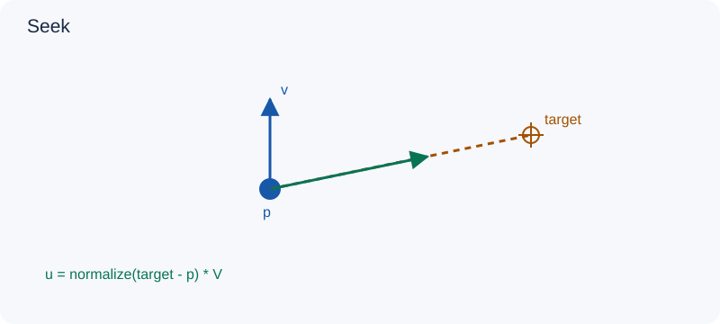

# Seek — buscar / approach

[Início / Home](Home.md) · [Fundamentos / Foundations](Foundations.md)

## Intuição / Intuition

Imagine um personagem que sempre tenta correr em direção a uma bandeira. `Seek` escolhe uma velocidade desejada apontando para o alvo; a aceleração corrige a diferença entre essa velocidade e a atual. Ele continua buscando velocidade máxima mesmo muito perto do destino.

**English.** A character runs toward a flag. Seek aims the desired velocity at the target, then accelerates to reduce the velocity error. It still requests maximum speed arbitrarily close to the destination; stopping is a separate policy.



Diagrama esquemático, sem escala. Azul: agente/velocidade; laranja: alvo/geometria;
verde: decisão desejada. Setas representam grandezas distintas, não uma trajetória calculada.
Schematic, not to scale. Blue: agent/velocity; orange: target/geometry; green: desired decision.
Arrows represent different quantities, not a simulated trajectory.

## Passo a passo / Pseudocode

Notação e funções auxiliares: [Fundamentos](Foundations.md). O resultado `a` é
aceleração; apenas o engine integra a posição. This is implementation-oriented
pseudocode, with helpers defined in Foundations; the engine integrates the result.

```text
offset = target - p
u = normalize(offset) * V
a = limit((u - v) / T, A)
return a
```

## Parâmetros / Parameters

| Entrada / Input | Efeito e ajuste / Effect and tuning |
| --- | --- |
| `target` | Posição fixa / fixed position. Recrie se mudar / rebuild if it changes. |
| `responseTime = 0.25` | T em segundos; menor corrige mais rápido até A / smaller T responds faster up to A. |

## Uso em Dart / Dart usage

Importe `package:steering_engine/steering_engine.dart`. Os trechos abaixo mostram
a configuração; `agent`, `dt`, `agents` e `targetSnapshot`, quando usados, são
snapshots do quadro atual. Veja o [loop completo](Foundations.md).
Import the public package; these are configuration snippets in the complete loop
from Foundations, using current-frame snapshots where applicable.

```dart
final behavior = Seek(Vec2(200, 100), responseTime: 0.25);
```

## Experimente / Try it

Com p=(0,0), v=(0,0), alvo=(100,0), V=10, A=20 e T=0.5, u=(10,0) e a=(20,0). Após dt=0.1, v=(2,0) e p=(0.2,0). / With these values the first step moves 0.2 units, not 2 units.

## Limites e diagnóstico / Limits and troubleshooting

Pode ultrapassar o alvo e oscilar: use Arrive para parar. Na sobreposição exata, normalize(0)=0 e Seek freia, sem direção inventada. / Can overshoot or oscillate; use Arrive to stop. At exact overlap desired velocity is zero, so it brakes.

## Implementação e leitura / Implementation and reading

- [Código / Source](https://github.com/kleberandrade/steering-engine/blob/main/lib/src/behaviors/individual/seek.dart)
- [Arrive](Arrive.md) · [Flee](Flee.md)
- [Receitas e diagnóstico / Recipes and troubleshooting](Recipes.md)

As fórmulas descrevem esta biblioteca, que adapta os conceitos de Reynolds.
These formulas describe this implementation; conceptual references are listed on [Home](Home.md).
