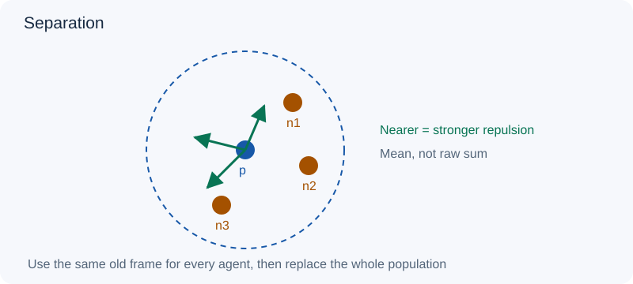

# Separation — manter espaço / keep space

[Início / Home](Home.md) · [Fundamentos / Foundations](Foundations.md)

## Intuição / Intuition

Cada vizinho próximo contribui com uma pequena repulsão. Quanto mais perto, maior sua contribuição. A média dessas contribuições impede que o número de vizinhos sozinho multiplique a força de separação.

**English.** Each neighbor contributes repulsion, strongest nearby and fading linearly to zero at the radius. Averaging prevents neighbor count alone from multiplying the result.



Diagrama esquemático, sem escala. Azul: agente/velocidade; laranja: alvo/geometria;
verde: decisão desejada. Setas representam grandezas distintas, não uma trajetória calculada.
Schematic, not to scale. Blue: agent/velocity; orange: target/geometry; green: desired decision.
Arrows represent different quantities, not a simulated trajectory.

## Passo a passo / Pseudocode

Notação e funções auxiliares: [Fundamentos](Foundations.md). O resultado `a` é
aceleração; apenas o engine integra a posição. This is implementation-oriented
pseudocode, with helpers defined in Foundations; the engine integrates the result.

```text
N = neighborsFor(originalAgent, radius=R)
contributions = []
for other in N:
    away = p - other.position
    contributions.append(normalize(away) * (1 - length(away)/R))
return limit(A * mean(contributions), A)
```

## Parâmetros / Parameters

| Entrada / Input | Efeito e ajuste / Effect and tuning |
| --- | --- |
| `neighborhood` | Observação única do quadro / shared current-frame observation. |
| `radius = 25` | R positivo; dentro dele a repulsão cresce linearmente / positive interaction radius. |

## Uso em Dart / Dart usage

Importe `package:steering_engine/steering_engine.dart`. Os trechos abaixo mostram
a configuração; `agent`, `dt`, `agents` e `targetSnapshot`, quando usados, são
snapshots do quadro atual. Veja o [loop completo](Foundations.md).
Import the public package; these are configuration snippets in the complete loop
from Foundations, using current-frame snapshots where applicable.

```dart
final observed = AgentNeighborhood(agents);
final behavior = Separation(observed, radius: 25);
```

## Experimente / Try it

Um único vizinho em (5,0), com p=(0,0), R=10 e A=20: a=(-10,0). Dois vizinhos simétricos cancelam. / A single neighbor yields (-10,0); symmetric contributions cancel.

## Limites e diagnóstico / Limits and troubleshooting

Não resolve colisões. Sobreposição exata contribui zero: não existe direção geométrica única. No limite R a contribuição é zero. Não subtrai a velocidade atual. / No collision solver, no invented overlap direction and no velocity matching.

## Implementação e leitura / Implementation and reading

- [Código / Source](https://github.com/kleberandrade/steering-engine/blob/main/lib/src/behaviors/group/separation.dart)
- [Alignment](Alignment.md) · [Cohesion](Cohesion.md) · [Flocking](Flocking.md)
- [Receitas e diagnóstico / Recipes and troubleshooting](Recipes.md)

As fórmulas descrevem esta biblioteca, que adapta os conceitos de Reynolds.
These formulas describe this implementation; conceptual references are listed on [Home](Home.md).
