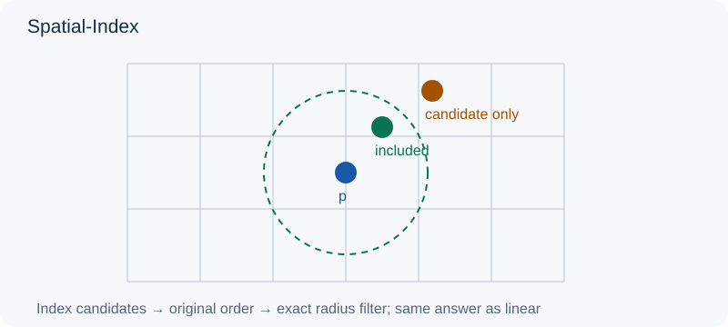

# Índice espacial / Spatial index

[Início / Home](Home.md) · [Flocking](Flocking.md)

## Intuição / Intuition

Perguntar a cada agente sobre todos os outros funciona em grupos pequenos, mas
faz aproximadamente n² verificações no grupo inteiro. Uma grade agrupa snapshots
em células: consulte as células que podem tocar o raio e filtre os candidatos
pela distância exata. A grade muda o custo da busca, não o significado de vizinho.

**English.** A uniform grid groups snapshots into cells. Query cells intersecting
the radius bounds, then apply the same exact distance filter as linear lookup.
It changes search cost, not neighbor semantics.



O quadrado indica células candidatas; o círculo define quem realmente é vizinho.
The rectangle selects candidate cells; the circle defines actual neighbors.

## Contrato da consulta / Query contract

`AgentNeighborhood(agents)` copia a população, deduplica instâncias repetidas
por identidade e preserva a ordem original. `neighborsFor(agent, radius: R)`
exclui apenas o próprio observador por identidade e inclui distância igual a R.
Dois agentes diferentes na mesma posição continuam sendo vizinhos.

The observation copies and identity-deduplicates input in original order.
Queries exclude only the observer instance and include the radius boundary.
Distinct agents at the same position remain neighbors. Pass the original snapshot.

```text
# Linear strategy
for other in observedAgentsInOriginalOrder:
    if other is not originalAgent and distance(p, other.position) <= R:
        emit other

# Optional grid strategy
build once from the current frame:
    put each snapshot + original ordinal into floor(position/cellSize)
query:
    if cell coordinates or query range are unsafe/too expensive:
        use the linear strategy
    collect candidates from cells intersecting padded query bounds
    sort candidates by original ordinal
    apply the identical identity and exact-radius filter
```

Os limites recebem margem numérica conservadora; só o filtro exato decide a
resposta. Casos extremos voltam à busca linear para preservar a correção.
Conservative numeric padding protects candidate selection; extreme coordinates
or costly cell ranges fall back to linear lookup.

## Uso e ajuste / Usage and tuning

```dart
import 'package:steering_engine/steering_engine.dart';

List<SteeringAgent> updateFlock(List<SteeringAgent> agents, double dt) {
  final observed = AgentNeighborhood.spatial(agents, cellSize: 80);
  final behavior = Flocking(observed);
  return [
    for (final agent in agents)
      const SteeringEngine().step(agent, behavior, dt),
  ];
}
```

| Opção / Option | Como escolher / How to choose |
| --- | --- |
| Linear | Simples e frequentemente melhor para poucos agentes / simple, often better for small populations |
| `cellSize = 80` | Comece perto do raio de consulta e meça / start near query radius and measure |
| Células pequenas / small cells | Menos candidatos por célula, mais células visitadas / fewer candidates, more cell visits |
| Células grandes / large cells | Menos células, mais candidatos por célula / fewer cells, more candidates |
| `usesSpatialIndex` | Inspeciona a estratégia construída; consultas ainda podem usar fallback / built strategy, not a no-fallback guarantee |

## Experimento / Experiment

Agente em (0,0), vizinhos em (3,4) e (6,0), R=5: só (3,4) entra, inclusive na
borda. Compare as duas estratégias e também a ordem dos resultados. Execute
`dart run example/spatial_index.dart` para a verificação pública completa.

At radius 5, (3,4) is included and (6,0) excluded. Linear and spatial results
must match in membership **and order**. Run the example for the full comparison.

## Custo e limites / Cost and limits

Em cenas esparsas a grade pode reduzir muito os candidatos; em uma célula lotada
ou raio enorme, o grupo ainda pode exigir O(n²). Construção, consultas e ordenação
têm custo: não assuma O(1) ou ganho universal.

Sparse scenes can benefit, but dense cells and large radii can retain O(n²)
whole-flock work. Index construction and candidate sorting also cost time.

Nas medições AOT da cena uniforme registrada, 1000 agentes deram mediana
66.07 ms linear contra 14.86 ms em grade; com 100, a grade foi mais lenta
(0.88 ms linear e 1.11 ms em grade). São condições específicas, sem renderização.
Veja [metodologia e dados](../benchmarks/README.md), não use como previsão de FPS.

Recorded uniform-scene AOT medians are fixture-specific and exclude rendering;
they are not FPS promises. See the methodology and raw reports before comparing.

O laboratório reposiciona nas bordas, mas a distância de vizinhança é euclidiana,
sem vizinhos através da emenda. Uma grade não muda essa regra.
Lab wrapping does not make neighbor distance toroidal.

[Código / Source](https://github.com/kleberandrade/steering-engine/blob/main/lib/src/perception/agent_neighborhood.dart)
· [Detalhes numéricos / Numeric details](../spatial_index.md)
