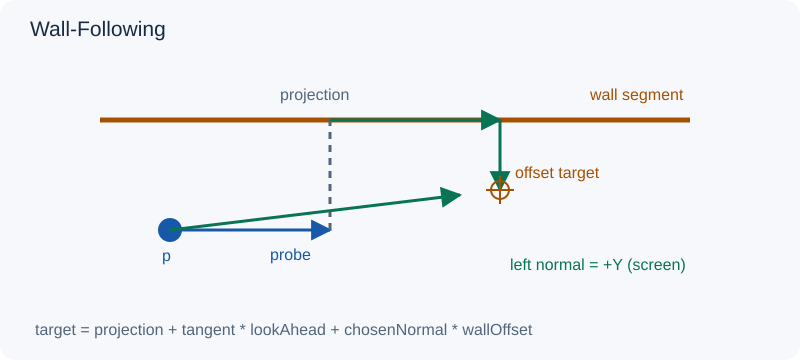

# Wall following — acompanhar paredes / follow walls

[Início / Home](Home.md) · [Fundamentos / Foundations](Foundations.md)

## Intuição / Intuition

Projete uma sonda à frente no segmento de parede mais próximo. Oriente a tangente para acompanhar o movimento e escolha um alvo um pouco adiante, deslocado pela normal. Seek leva o agente a esse alvo local.

**English.** Project a forward probe onto the nearest finite wall segment. Orient the tangent along travel and seek a target ahead of the projection, offset along the selected normal.



Diagrama esquemático, sem escala. Azul: agente/velocidade; laranja: alvo/geometria;
verde: decisão desejada. Setas representam grandezas distintas, não uma trajetória calculada.
Schematic, not to scale. Blue: agent/velocity; orange: target/geometry; green: desired decision.
Arrows represent different quantities, not a simulated trajectory.

## Passo a passo / Pseudocode

Notação e funções auxiliares: [Fundamentos](Foundations.md). O resultado `a` é
aceleração; apenas o engine integra a posição. This is implementation-oriented
pseudocode, with helpers defined in Foundations; the engine integrates the result.

```text
h = normalize(v) if moving else normalize(fallbackDirection)
probe = p + h*lookAhead
wall, projected = nearest finite segment projection to probe
if no wall within maxDistance: return zero
t = normalize(wall.end - wall.start)
if dot(t,h) < 0: t = -t
normal = (-t.y,t.x) * (+1 if side==left else -1)
target = projected + t*lookAhead + normal*wallOffset
return Seek(target, responseTime=T).calculate(agent, dt)
```

## Parâmetros / Parameters

| Entrada / Input | Efeito e ajuste / Effect and tuning |
| --- | --- |
| `wallOffset = 20` | Distância à parede, >= 0 / nonnegative offset. |
| `lookAhead = 30` | Avanço da sonda e do alvo / probe and tangent target advance. |
| `maxDistance = 100` | Alcance de aquisição medido da sonda / acquisition radius from probe. |
| `side = WallSide.left` | Normal (-ty,tx); em canvas +Y aponta para baixo / algebraic side, screen Y may point down. |
| `fallbackDirection = (1,0)`, `responseTime = 0.25` | Direção parado e resposta / stationary heading and response. |

## Uso em Dart / Dart usage

Importe `package:steering_engine/steering_engine.dart`. Os trechos abaixo mostram
a configuração; `agent`, `dt`, `agents` e `targetSnapshot`, quando usados, são
snapshots do quadro atual. Veja o [loop completo](Foundations.md).
Import the public package; these are configuration snippets in the complete loop
from Foundations, using current-frame snapshots where applicable.

```dart
final behavior = WallFollowing([
  WallSegment(Vec2(0, 0), Vec2(200, 0)),
], wallOffset: 20, lookAhead: 30, side: WallSide.left);
```

## Experimente / Try it

Parede de (0,0) a (200,0), p=(20,20), h=(1,0), lookAhead=30 e offset=20: sonda=(50,20), projeção=(50,0), alvo=(80,20). / The target remains 20 units off the wall.

## Limites e diagnóstico / Limits and troubleshooting

A projeção é limitada às extremidades do segmento; o alvo tangencial pode ficar além delas. Cantos podem oscilar. Não é wall avoidance nem resolvedor de contato. Listas vazias e paredes fora de alcance retornam zero. / Local following only; corners can oscillate and no collision resolution is implied.

## Implementação e leitura / Implementation and reading

- [Código / Source](https://github.com/kleberandrade/steering-engine/blob/main/lib/src/navigation/wall_following.dart)
- [Path following](Path-Following.md) · [Seek](Seek.md)
- [Receitas e diagnóstico / Recipes and troubleshooting](Recipes.md)

As fórmulas descrevem esta biblioteca, que adapta os conceitos de Reynolds.
These formulas describe this implementation; conceptual references are listed on [Home](Home.md).
