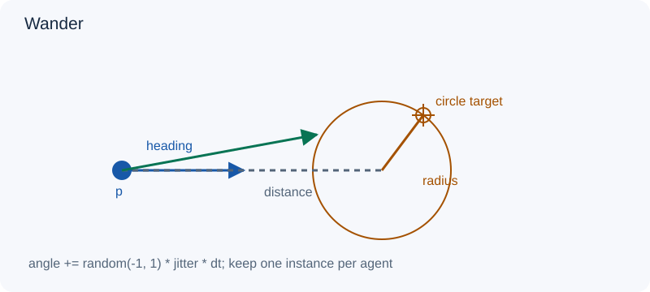

# Wander — explorar / wander

[Início / Home](Home.md) · [Fundamentos / Foundations](Foundations.md)

## Intuição / Intuition

Um alvo aleatório novo a cada quadro causa tremores. Wander conserva um ângulo e o altera aos poucos em um círculo à frente. A direção do círculo acompanha a velocidade; parado, usa +X. Esse estado dá continuidade à exploração.

**English.** Independent random targets can jitter. Wander retains an angle, perturbs it gradually, and selects a point on a circle ahead of the agent. The circle follows velocity, using +X when stopped.



Diagrama esquemático, sem escala. Azul: agente/velocidade; laranja: alvo/geometria;
verde: decisão desejada. Setas representam grandezas distintas, não uma trajetória calculada.
Schematic, not to scale. Blue: agent/velocity; orange: target/geometry; green: desired decision.
Arrows represent different quantities, not a simulated trajectory.

## Passo a passo / Pseudocode

Notação e funções auxiliares: [Fundamentos](Foundations.md). O resultado `a` é
aceleração; apenas o engine integra a posição. This is implementation-oriented
pseudocode, with helpers defined in Foundations; the engine integrates the result.

```text
if dt > 0:
    angle = (angle + uniform(-1, 1) * jitter * dt) modulo (2*pi)
h = normalize(v) if length(v) > 0 else (1, 0)
s = (-h.y, h.x)
offset = h*(distance + cos(angle)*radius) + s*sin(angle)*radius
return Seek(p + offset, responseTime=T).calculate(agent, dt)
```

## Parâmetros / Parameters

| Entrada / Input | Efeito e ajuste / Effect and tuning |
| --- | --- |
| `jitter = 2` | Radianos/s da perturbação máxima por amostra / angular perturbation rate. |
| `distance = 50`, `radius = 25` | Círculo à frente; raio maior dá desvios maiores / forward circle geometry. |
| `seed` | Repete chamadas no mesmo runtime / repeats a matching call sequence on the same runtime. |
| `responseTime = 0.25` | Resposta da velocidade / velocity response time. |

## Veja em movimento / See it move

[Abra esta cena no laboratório / Open this lab scene](https://kleberandrade.github.io/steering-engine/?mode=Wander)

Pause, avance um passo e compare os vetores com o diagrama acima.
Pause, single-step and compare the vectors with the diagram above.

## Uso em Dart / Dart usage

Importe `package:steering_engine/steering_engine.dart`. Os trechos abaixo mostram
a configuração; `agent`, `dt`, `agents` e `targetSnapshot`, quando usados, são
snapshots do quadro atual. Veja o [loop completo](Foundations.md).
Import the public package; these are configuration snippets in the complete loop
from Foundations, using current-frame snapshots where applicable.

```dart
// Crie uma vez por agente, fora do loop. / Once per agent, outside the loop.
final behavior = Wander(seed: 42, distance: 50, radius: 25, jitter: 2);
```

## Experimente / Try it

Com ângulo=0 e h=(1,0), o primeiro alvo sem perturbação fica distance+radius à frente. Compare jitter=0 com jitter=2 e acompanhe o ponto no círculo. / Compare zero jitter and nonzero jitter while watching the circle target.

## Limites e diagnóstico / Limits and troubleshooting

Uma instância por agente, uma avaliação por passo. Compartilhar mistura os estados. dt=0 não muda o ângulo nem consome amostras. Alterar dt altera a sequência espacial, mesmo com seed igual. / Per-agent state; no promise of identical trajectories across time steps or runtimes.

## Implementação e leitura / Implementation and reading

- [Código / Source](https://github.com/kleberandrade/steering-engine/blob/main/lib/src/behaviors/individual/wander.dart)
- [Weighted blend](Weighted-Blend.md) · [Foundations](Foundations.md)
- [Receitas e diagnóstico / Recipes and troubleshooting](Recipes.md)

As fórmulas descrevem esta biblioteca, que adapta os conceitos de Reynolds.
These formulas describe this implementation; conceptual references are listed on [Home](Home.md).
