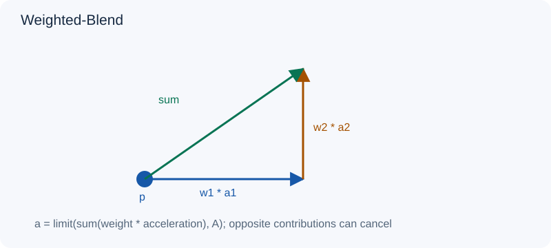

# Weighted blend — misturar decisões / blend decisions

[Início / Home](Home.md) · [Fundamentos / Foundations](Foundations.md)

## Intuição / Intuition

Dois objetivos podem atuar ao mesmo tempo. Multiplique a aceleração de cada regra por um peso, some e limite a saída. O peso é um ganho, não uma porcentagem: não há normalização automática.

**English.** Let multiple goals act simultaneously. Multiply each acceleration by its weight, sum the contributions, then cap the result. Weights are gains, not automatically normalized percentages.



Diagrama esquemático, sem escala. Azul: agente/velocidade; laranja: alvo/geometria;
verde: decisão desejada. Setas representam grandezas distintas, não uma trajetória calculada.
Schematic, not to scale. Blue: agent/velocity; orange: target/geometry; green: desired decision.
Arrows represent different quantities, not a simulated trajectory.

## Passo a passo / Pseudocode

Notação e funções auxiliares: [Fundamentos](Foundations.md). O resultado `a` é
aceleração; apenas o engine integra a posição. This is implementation-oriented
pseudocode, with helpers defined in Foundations; the engine integrates the result.

```text
sum = zero
for entry in entries:
    if entry.weight == 0: continue  # skip evaluation, including state changes
    sum += entry.behavior.calculate(agent, dt) * entry.weight
return limit(sum, A)
```

## Parâmetros / Parameters

| Entrada / Input | Efeito e ajuste / Effect and tuning |
| --- | --- |
| `entries` | Lista copiada e imutável de WeightedBehavior / copied immutable entries. |
| `weight = 1` | Peso finito >= 0; zero desativa avaliação / finite nonnegative gain; zero skips evaluation. |

## Uso em Dart / Dart usage

Importe `package:steering_engine/steering_engine.dart`. Os trechos abaixo mostram
a configuração; `agent`, `dt`, `agents` e `targetSnapshot`, quando usados, são
snapshots do quadro atual. Veja o [loop completo](Foundations.md).
Import the public package; these are configuration snippets in the complete loop
from Foundations, using current-frame snapshots where applicable.

```dart
final behavior = WeightedBlend([
  WeightedBehavior(Arrive(Vec2(300, 100)), weight: 0.8),
  WeightedBehavior(Wander(seed: 42), weight: 0.2),
]);
// Preserve para manter o estado de Wander. / Retain the nested Wander state.
```

## Experimente / Try it

Com a1=(10,0), a2=(0,10), pesos 2 e 1, soma=(20,10); se A=10, saída≈(8.94,4.47). Não divida pela soma dos pesos. / The capped vector is approximately (8.94,4.47), not a normalized weighted average.

## Limites e diagnóstico / Limits and troubleshooting

Regras opostas podem cancelar e impedir chegada. Para evitar que o objetivo anule um desvio, prefira PrioritySteering. Comportamentos customizados são somados como retornados; a limitação global ocorre após a soma. / Conflicting goals can cancel; priority is often preferable for avoidance.

## Implementação e leitura / Implementation and reading

- [Código / Source](https://github.com/kleberandrade/steering-engine/blob/main/lib/src/composition/weighted_blend.dart)
- [Priority steering](Priority-Steering.md) · [Flocking](Flocking.md)
- [Receitas e diagnóstico / Recipes and troubleshooting](Recipes.md)

As fórmulas descrevem esta biblioteca, que adapta os conceitos de Reynolds.
These formulas describe this implementation; conceptual references are listed on [Home](Home.md).
